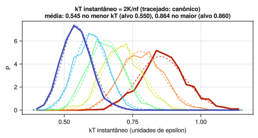
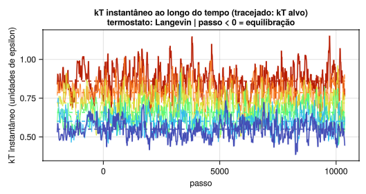
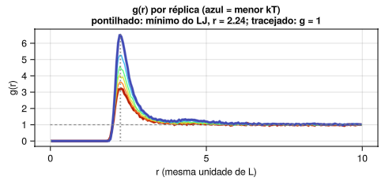
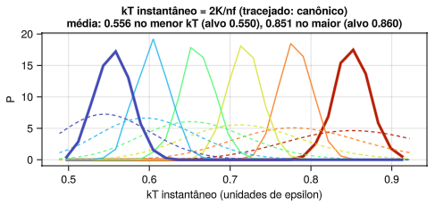

# Tutorial de Replica Exchange MD

Este tutorial apresenta o método de Replica Exchange Molecular Dynamics em temperatura (T-REMD) usando a interface gráfica do pacote Julia `ReplicaExchangeTutorial`. A proposta é variar um parâmetro de cada vez, observar o efeito na amostragem e, a partir disso, discutir como diagnosticar e corrigir problemas.

Os tópicos são:

- o problema que o REMD resolve e o que o método garante;
- os parâmetros de controle e o efeito de cada um;
- como reconhecer, nos gráficos, uma escada de temperaturas adequada;
- o que variar quando a amostragem falha;
- como esses parâmetros aparecem numa simulação molecular.

Pré-requisitos: noções de dinâmica molecular (integração, termostato, energia potencial) e do ensemble canônico. Não é preciso conhecer Julia.

*[Read this tutorial in English](tutorial_en.md).*

Na seção 9, os testes 1, 2 (com 2 réplicas), 8 e 9 foram rodados na GUI (semente 42, 20 000 passos) e têm os resultados marcados como *observado*, com as figuras salvas pela própria interface. Nos demais, os resultados marcados como *esperado* são previsões que devem ser conferidas. Os valores numéricos variam com a semente e com a duração da corrida.

## Sumário

1. [O problema que o REMD resolve](#1-o-problema-que-o-remd-resolve)
2. [A ideia do método](#2-a-ideia-do-método)
3. [O critério de troca](#3-o-critério-de-troca)
4. [O sistema-modelo da GUI](#4-o-sistema-modelo-da-gui)
5. [Instalação e primeira execução](#5-instalação-e-primeira-execução)
6. [Visita guiada à janela](#6-visita-guiada-à-janela)
7. [Primeira simulação, passo a passo](#7-primeira-simulação-passo-a-passo)
8. [Os parâmetros de controle](#8-os-parâmetros-de-controle)
9. [Testes](#9-testes)
10. [Diagnóstico: do sintoma ao parâmetro](#10-diagnóstico-do-sintoma-ao-parâmetro)
11. [Da GUI para uma simulação molecular](#11-da-gui-para-uma-simulação-molecular)
12. [Salvando figuras e trajetórias](#12-salvando-figuras-e-trajetórias)
13. [Problemas comuns ao usar a GUI](#13-problemas-comuns-ao-usar-a-gui)
14. [Limitações do modelo](#14-limitações-do-modelo)
15. [Glossário](#15-glossário)
16. [Referências](#16-referências)

---

## 1. O problema que o REMD resolve

Uma simulação de dinâmica molecular a temperatura T visita os estados do sistema com probabilidade proporcional a exp(−U/kT). Em princípio, uma trajetória longa o bastante visita tudo o que importa. Na prática, as regiões de baixa energia costumam estar separadas por barreiras, e o tempo médio de espera para cruzar uma barreira de energia livre de altura ΔG‡ cresce exponencialmente:

```math
\tau \propto \exp\left(\frac{\Delta G^{\ddagger}}{kT}\right)
```

Quando ΔG‡ é muito maior que kT, a simulação fica presa no mínimo local de energia livre (o estado metaestável) onde começou. As médias calculadas convergem, mas para as propriedades desse mínimo, não para as do ensemble. Esse comportamento é chamado de quasi-ergodicidade. Ele é difícil de detectar, porque a própria simulação não indica que há regiões não visitadas.

Aumentar a temperatura resolve a barreira (τ cai exponencialmente), mas então a simulação amostra o ensemble errado: o da temperatura alta. O REMD é uma forma de usar a temperatura alta para cruzar barreiras e, ainda assim, obter o ensemble correto na temperatura baixa.

## 2. A ideia do método

Simulam-se R cópias do mesmo sistema, chamadas **réplicas**, cada uma numa temperatura diferente: T₁ < T₂ < … < T_R. O conjunto das temperaturas é a **escada** (em inglês, *temperature ladder*).

- A réplica em T₁ é a de interesse (a **réplica de referência**).
- As réplicas em temperaturas altas cruzam barreiras com facilidade.
- De tempos em tempos, duas réplicas de temperaturas vizinhas tentam **trocar de configuração**. Se a troca é aceita, a configuração que estava em T₂ passa a ser simulada em T₁, e vice-versa.

Com isso, uma configuração que cruzou uma barreira lá em cima pode descer a escada, degrau por degrau, até chegar a T₁. A réplica de referência recebe configurações de mínimos locais que ela nunca alcançaria sozinha.

**Estado e walker**

| Termo | O que é | Na GUI |
| --- | --- | --- |
| **Estado** | Uma temperatura da escada. É fixo. | Cada painel da direita; o kT no título nunca muda |
| **Walker** (configuração) | Um conjunto de posições e velocidades que passeia pela escada | A cor das partículas |

Quando uma troca é aceita, os dois walkers trocam de painel. As temperaturas dos painéis não mudam; o que muda é a configuração que está em cada uma. É importante manter essa distinção, porque as análises podem ser feitas por estado (o que interessa para as médias) ou por walker (o que interessa para avaliar a **circulação** das configurações pela escada, chamada em inglês de *replica mixing*).

**O que o método garante**

Se o critério de troca for o correto (seção 3), cada estado continua amostrando exatamente o ensemble canônico da sua temperatura. Nada é forçado nem enviesado. As médias calculadas no estado T₁ são médias canônicas em T₁, sem necessidade de reponderação.

**O que o método não garante**

- Que a réplica mais quente cruze as barreiras. Isso depende de T_R ser alto o suficiente.
- Que as configurações desçam a escada. Isso depende de as trocas serem aceitas em todos os degraus.
- Informação sobre a cinética. As trocas interrompem a dinâmica física: o REMD fornece populações e médias, não tempos nem taxas.

## 3. O critério de troca

### 3.1 A fórmula

Considere dois estados vizinhos i e j, com temperaturas T_i < T_j e β = 1/kT. A configuração que está em i tem energia potencial U_i; a que está em j tem U_j. A troca é aceita com probabilidade

```math
P_{\text{acc}} = \min\left\{1,\ \exp\left[\left(\beta_i - \beta_j\right)\left(U_i - U_j\right)\right]\right\}
```

### 3.2 De onde ela vem

O sistema estendido (todas as réplicas juntas) tem probabilidade conjunta igual ao produto dos fatores de Boltzmann de cada estado. Antes da troca, o peso do par é

```math
w_{\text{antes}} = e^{-\beta_i U_i}\, e^{-\beta_j U_j}
```

Depois da troca, a configuração de energia U_j está em β_i e a de energia U_i está em β_j:

```math
w_{\text{depois}} = e^{-\beta_i U_j}\, e^{-\beta_j U_i}
```

A razão entre os dois é

```math
\frac{w_{\text{depois}}}{w_{\text{antes}}} = \exp\left[\left(\beta_i - \beta_j\right)\left(U_i - U_j\right)\right]
```

Aceitar a troca com probabilidade min{1, razão} é a regra de Metropolis. Ela satisfaz o **balanço detalhado** (*detailed balance*, a reversibilidade microscópica) no ensemble estendido: no equilíbrio, cada troca acontece com a mesma frequência que a troca inversa. Um processo com essa propriedade não altera a distribuição de equilíbrio, e por isso cada estado continua canônico.

### 3.3 Como ler a fórmula

Como T_i < T_j, o fator (β_i − β_j) é positivo.

- Se U_i > U_j (a configuração no estado frio tem energia **maior** que a do estado quente), o expoente é positivo e a troca é **sempre aceita**. Faz sentido: a configuração de menor energia vai para a temperatura menor.
- Se U_i < U_j (o caso mais comum), a probabilidade cai exponencialmente com a diferença de energia e com a distância entre as temperaturas.

Portanto, só há trocas se as duas réplicas puderem ter energias parecidas, isto é, se as distribuições de energia P(U) dos dois estados se sobrepuserem. Essa relação entre sobreposição e taxa de troca é usada em todo o restante do tutorial.

### 3.4 E a energia cinética?

A fórmula usa só a energia potencial. A energia cinética sai da conta porque, quando a troca é aceita, as velocidades de cada configuração são reescaladas para a nova temperatura:

```math
v_{\text{novo}} = v_{\text{antigo}} \sqrt{\frac{T_{\text{novo}}}{T_{\text{antigo}}}}
```

Com esse reescalonamento, os termos cinéticos se cancelam exatamente na razão de pesos. A GUI faz isso em toda troca aceita.

### 3.5 Quais pares tentam trocar

Só **vizinhos** na escada tentam trocar, porque pares distantes quase nunca teriam sobreposição. Para que todos os pares sejam testados sem que um estado participe de duas trocas ao mesmo tempo, as tentativas alternam entre dois conjuntos:

- rodadas ímpares: pares 1-2, 3-4, 5-6, …
- rodadas pares: pares 2-3, 4-5, …

Cada par é testado uma vez a cada duas rodadas. É o mesmo esquema usado pelo GROMACS.

## 4. O sistema-modelo da GUI

### 4.1 O que é simulado

Partículas idênticas em duas dimensões, numa caixa quadrada com condições periódicas de contorno, interagindo pelo potencial de Lennard-Jones:

```math
U(r) = 4\,\varepsilon\left[\left(\frac{\sigma}{r}\right)^{12} - \left(\frac{\sigma}{r}\right)^{6}\right]
```

- ε (epsilon) é a profundidade do poço: a energia ganha quando duas partículas ficam na distância ideal.
- σ (sigma) é o diâmetro efetivo da partícula. O mínimo do potencial fica em r = 2^(1/6) σ ≈ 1,12 σ.

Não há raio de corte: todos os pares entram na soma, usando a imagem periódica mais próxima (convenção da imagem mínima). Isso torna o cálculo lento para muitas partículas (custo proporcional a n²), mas evita os artefatos de truncamento do potencial na energia usada no critério de troca. Como L é muito maior que σ, a contribuição das demais imagens é desprezível.

### 4.2 Unidades

A GUI usa unidades reduzidas:

| Grandeza | Unidade |
| --- | --- |
| Massa | massa da partícula = 1 |
| Energia | ε (com o padrão ε = 1, os números da tela já estão em unidades de ε) |
| Temperatura | dada como kT, em unidades de energia. kT = 0,5 significa T = 0,5 ε/k_B |
| Comprimento | arbitrária; com o padrão, σ = 2 e L = 100 |
| Tempo | derivada das anteriores: (unidade de comprimento) × √(massa/ε). dt e 1/gamma estão nessa unidade |

Com os valores padrão (n = 100, L = 100, σ = 2), as partículas ocupam cerca de 3 % da área da caixa. O sistema é **diluído**.

### 4.3 Por que esse sistema serve para estudar REMD

O comportamento muda com a temperatura:

- **kT alto**: as partículas se espalham como um gás. A energia potencial fica perto de zero.
- **kT baixo**: as partículas se juntam em aglomerados, e a energia potencial fica bem negativa.

Formar, desfazer e reorganizar aglomerados é um processo lento em kT baixo: para um aglomerado mudar, partículas precisam se soltar, o que custa energia. Esse processo faz o papel que as barreiras conformacionais têm numa molécula. Em kT alto os aglomerados se desfazem com facilidade, e é isso que as réplicas quentes oferecem às frias.

Além disso, a capacidade calorífica do sistema varia com a temperatura (é maior na região onde os aglomerados se formam), o que torna a escolha da escada um problema não trivial, como em sistemas reais.

### 4.4 Como cada réplica é propagada

Cada réplica segue a **dinâmica de Langevin**, integrada com o esquema BAOAB:

```math
m\,\ddot{x} = F(x) - \gamma\, m\, \dot{x} + \sqrt{2\,\gamma\, m\, kT}\;\eta(t)
```

O termo de atrito (γ) e o ruído aleatório (η) juntos funcionam como termostato: mantêm a réplica no ensemble canônico da sua temperatura. O atrito é o campo "gamma (1/τ do termostato)" da GUI. O Langevin é o termostato padrão; a GUI oferece também Bussi, Berendsen, Nosé-Hoover e nenhum termostato (NVE), discutidos na seção 8.3.

As réplicas são independentes entre uma tentativa de troca e a seguinte, e a GUI as propaga em paralelo, uma por thread.

## 5. Instalação e primeira execução

### 5.1 Requisitos

- Julia 1.10 ou mais recente. Baixe em https://julialang.org/downloads/ ou use o `juliaup`.
- Suporte a OpenGL 3.3 (exigência do pacote gráfico GLMakie). Qualquer computador com placa de vídeo dos últimos anos atende.
- Testado em Ubuntu 20.04. Para Windows, veja a seção 5.5.

### 5.2 Instalar o pacote (uma vez)

A GUI é distribuída como o pacote Julia `ReplicaExchangeTutorial`. No REPL do Julia, digite:

```julia
julia> import Pkg; Pkg.add("ReplicaExchangeTutorial")
```

Isso instala o pacote e o GLMakie, com suas dependências, e compila tudo. Demora alguns minutos.

O mesmo pode ser feito pelo modo de pacotes do REPL: aperte `]` (o prompt muda de `julia>` para `pkg>`), digite `add ReplicaExchangeTutorial` e aperte Backspace para voltar. O `add` sozinho só funciona dentro desse modo; digitado no prompt `julia>`, dá erro de sintaxe.

### 5.3 Abrir a GUI

Inicie o Julia com uma thread por núcleo e abra a interface:

```bash
julia -t auto
```

```julia
julia> using ReplicaExchangeTutorial
julia> remd_gui()
```

- `-t auto` faz o Julia usar uma thread por núcleo. Cada réplica roda numa thread, então com 6 réplicas, 6 threads já aproveitam todo o paralelismo. Sem `-t auto`, a GUI avisa no terminal e roda as réplicas em série.
- A primeira abertura é lenta (pode passar de um minuto) porque o Julia compila o código gráfico. As seguintes são mais rápidas.
- Figuras e trajetórias são salvas a partir da pasta em que o Julia está (`pwd()`). Para salvar em outro lugar, use `cd("caminho/da/pasta")` antes de `remd_gui()`.

Para abrir com um único comando no terminal:

```bash
julia -t auto -e 'using ReplicaExchangeTutorial; wait(display(remd_gui()))'
```

Se a janela abrir mostrando os painéis com as partículas espalhadas, a instalação está correta.

### 5.4 Alternativa: a partir do repositório

Para ler ou modificar o código, clone o repositório e use o script da raiz:

```bash
git clone https://github.com/LP-IQ/ReplicaExchangeTutorial.jl.git
cd ReplicaExchangeTutorial.jl
julia -t auto remd_gui.jl
```

O script ativa o ambiente do próprio repositório e, na primeira vez, instala as dependências. O código da simulação está em `src/simulacao.jl` e o da interface em `src/interface.jl`. Os testes automáticos rodam com `import Pkg; Pkg.test("ReplicaExchangeTutorial")`.

### 5.5 Windows

O pacote é o mesmo; mudam só a instalação do Julia e a forma de abrir.

1. **Julia.** Instale pelo instalador de https://julialang.org/downloads/ ou, no PowerShell, com `winget install --name Julia --id 9NJNWW8PVKMN -e -s msstore` (instala o `juliaup`). Feche e reabra o terminal e confira com `julia --version`.
2. **Abrir o Julia com threads.** No PowerShell, digite `julia -t auto`. O atalho do menu Iniciar abre o Julia com uma thread só; a GUI funciona, mas mais devagar.
3. **Instalar e abrir.** No REPL, faça como nas seções 5.2 e 5.3:

   ```julia
   julia> import Pkg; Pkg.add("ReplicaExchangeTutorial")
   julia> using ReplicaExchangeTutorial
   julia> remd_gui()
   ```

Alternativa sem digitar comandos: baixe o repositório (no GitHub, **Code → Download ZIP**), extraia a pasta e dê duplo clique em `run_windows.bat`. Ele roda `julia -t auto remd_gui.jl` na pasta certa, instala as dependências na primeira vez e mantém a janela do terminal aberta para mostrar mensagens de erro. Nesse caso, figuras e trajetórias são salvas na pasta do repositório.

Para abrir a trajetória no VMD, veja a seção 12.2.

## 6. Visita guiada à janela

A janela tem três colunas: controles à esquerda, gráficos no centro e réplicas à direita. Há ainda uma linha de mensagens no rodapé.


### 6.1 Coluna da esquerda: controles

**Campos de texto.** Clique no campo, digite o valor e pressione Enter. Use ponto como separador decimal.

| Campo | Padrão | Significado |
| --- | --- | --- |
| réplicas (máx 12) | 6 | Número de temperaturas, usado pelo botão "Gerar escada geométrica" |
| kT mín (em epsilon) | 0,55 | Menor temperatura, usada pelo mesmo botão |
| kT máx (em epsilon) | 0,86 | Maior temperatura, usada pelo mesmo botão |
| kTs | 0.550,0.601,0.658,0.719,0.786,0.860 | A lista de temperaturas que a simulação usa de fato, separadas por vírgula |
| n partículas | 100 | Número de partículas em cada réplica |
| L (caixa) | 100 | Lado da caixa quadrada |
| dt | 0,05 | Passo de integração |
| nsteps | 20000 | Passos executados a cada clique em Run |
| troca a cada (passos) | 50 | Passos de dinâmica entre duas rodadas de tentativas de troca |
| pausa se trocou (s) | 0,3 | Tempo que a tela congela quando uma troca é aceita (só visualização) |
| equilibração | 2000 | Passos sem trocas executados pelo botão 1 |
| kT inicial (× alvo) | 1,0 | As velocidades iniciais são sorteadas nesse múltiplo do kT de cada estado. Use 2 para começar quente e ver o termostato trazer a temperatura de volta (teste 10) |
| gamma (1/τ do termostato) | 0,1 | No Langevin, o coeficiente de atrito. Nos outros termostatos, o inverso do tempo de acoplamento τ |
| epsilon (poço LJ) | 1,0 | Profundidade do poço de Lennard-Jones |
| sigma (diâmetro LJ) | 2,0 | Diâmetro das partículas |
| semente (0 = aleatória) | 0 | Semente dos números aleatórios |

**Atenção**: os campos "réplicas", "kT mín" e "kT máx" não entram diretamente na simulação. Eles só servem para o botão "Gerar escada geométrica" preencher o campo **kTs**, que é o que vale.

**Quando cada mudança passa a valer**

| Campo alterado | Passa a valer |
| --- | --- |
| kTs, n, L, epsilon, sigma, semente, termostato | Só depois de clicar em Reset ou no botão 1 (o sistema é recriado) |
| dt, gamma, nsteps, troca a cada, pausa | No próximo clique em Run |
| equilibração, kT inicial | No próximo clique no botão 1 |

**Menus e chave**

| Controle | Opções | Função |
| --- | --- | --- |
| termostato | "Langevin" / "Bussi (v-rescale)" / "Berendsen" / "Nosé-Hoover" / "Nenhum (NVE)" | Como cada réplica é mantida na sua temperatura (seção 8.3) |
| Teste | "1: referência" a "10d: sem termostato" | Preenche os campos com a configuração de um teste da seção 9 |
| Cores | "Destaque" / "Colorido" | Como os walkers são pintados (seção 6.4) |
| Mapa | "Ocupação" / "Menor energia" / "Taxa de troca (kT)" / "Trocas entre walkers" | Qual mapa aparece no painel inferior direito do centro (seção 6.3) |
| Gráfico | "P(U)" / "g(r)" / "kT instantâneo" / "kT no tempo" | O que aparece no painel do meio, à direita (seção 6.3) |
| menor U no random walk | ligado / desligado | Mostra, no random walk, em que kT estava a configuração de menor energia; com a chave ligada, as linhas dos walkers ficam mais claras para destacar esses pontos |

**Botões**

| Botão | O que faz |
| --- | --- |
| Gerar escada geométrica | Preenche kTs com uma progressão geométrica entre kT mín e kT máx |
| 1. Minimizar + Equilibrar | Recria o sistema, minimiza a energia e equilibra cada réplica no seu kT, sem trocas |
| 2. Run | Roda o REMD por nsteps passos. Um novo clique continua de onde parou |
| Stop | Interrompe a equilibração ou a corrida em andamento |
| Reset | Recria o sistema com os valores dos campos. Se houver corrida em andamento, o primeiro clique a interrompe e o segundo recria |
| Salvar figuras (PNG por gráfico) | Grava um PNG de cada gráfico (seção 12) |
| Salvar trajetória do menor kT (XYZ) | Grava a trajetória da réplica de referência (seção 12) |

**Texto de estatísticas.** Abaixo dos botões aparece, durante a corrida:

```
Taxa de troca acumulada por par de kT:
0.55-0.60: 0.61 (122/200)
...
Round trips (kT mín-máx-mín): 42
  por walker: 6 6 6 9 10 5
```

Cada linha de par mostra as duas temperaturas, a fração de trocas aceitas e, entre parênteses, aceitas/tentadas.

### 6.2 Coluna da direita: as réplicas

Um painel por estado, do menor kT (primeiro) ao maior (último). O título de cada um traz:

- `kT=…`: a temperatura do estado (fixa).
- `U=…`: a energia potencial da configuração que está ali agora.
- `P(->)=…`: a probabilidade calculada na última tentativa de troca com o próximo estado.
- `Trocou` em verde ou `Falhou` em vermelho: o resultado da tentativa da rodada mais recente. Como os pares alternam, um estado que não participou dessa rodada fica sem essa indicação.

Um dos painéis tem **moldura magenta grossa**: é o estado que contém, naquele instante, a configuração de menor energia potencial entre todas.

### 6.3 Coluna central: os gráficos

**Random walk das configurações** (topo). Eixo x: número da rodada de tentativas de troca. Eixo y: índice do estado (1 = menor kT). Há uma linha por walker, mostrando em que estado ele estava a cada tentativa. É o gráfico mais importante para avaliar a circulação das configurações.

**Energia potencial por réplica** (meio, esquerda). Uma curva por estado, de azul (menor kT) a vermelho (maior kT). Mostra a média móvel da energia, para suavizar o ruído.
- Passos negativos são a equilibração; a linha tracejada vertical em 0 marca o início das trocas.
- As curvas dos dois extremos são mais grossas.
- O título mostra a média de U no menor e no maior kT.

**P(U), g(r), kT instantâneo ou kT no tempo** (meio, direita). O menu "Gráfico" escolhe o que aparece. Em todos há uma curva por estado, com as mesmas cores. Os três primeiros são acumulados apenas durante o Run; o kT no tempo inclui a equilibração.

- **P(U)**: o histograma da energia potencial. Mostra diretamente a sobreposição que controla a taxa de troca.
- **g(r)**: a função de distribuição radial, a probabilidade de achar uma partícula a uma distância r de outra, relativa a um gás ideal de mesma densidade. g(r) = 1 é a linha tracejada; a linha pontilhada marca o mínimo do potencial, r = 2^(1/6) σ. Picos altos indicam aglomerados. É o observável estrutural da GUI.
- **kT instantâneo**: o histograma de 2K/n_f, a temperatura calculada a partir da energia cinética K, com n_f graus de liberdade. As curvas tracejadas são a distribuição esperada no ensemble canônico. Serve para julgar o termostato (seção 8.3).
- **kT no tempo**: o kT instantâneo de cada estado ao longo da simulação, com o kT alvo tracejado na mesma cor. Mostra o termostato trabalhando: a faixa em que ele mantém a temperatura e, começando quente (campo "kT inicial"), como ele a traz de volta.

Os dois gráficos de temperatura no teste 1 (Langevin, passo 10 360). No histograma, as curvas medidas seguem as canônicas tracejadas; a média ficou em 0,545 no menor kT (alvo 0,550) e 0,864 no maior (alvo 0,860). Na série temporal, cada estado flutua em torno do seu alvo numa faixa de cerca de ±10 %, o valor canônico para 2n = 200 graus de liberdade (√(2/200) = 0,10).

| kT instantâneo | kT no tempo |
| --- | --- |
|  |  |

**Réplica de referência** (embaixo, esquerda). Uma visão ampliada do estado de menor kT. O título diz qual walker está lá e sua energia.

**Mapa** (embaixo, direita). Um de quatro mapas, conforme o menu "Mapa":

| Mapa | Eixos | Cada célula mostra | Valor ideal |
| --- | --- | --- | --- |
| Ocupação | kT × walker | Fração do tempo que o walker passou naquele kT | 1/R em todas |
| Menor energia | kT × walker | Fração do tempo em que a configuração de menor U estava naquele kT e era aquele walker. O título dá a soma por kT | Concentrado nos kT baixos, espalhado entre walkers |
| Taxa de troca (kT) | kT × kT | Trocas aceitas / tentadas entre dois kT vizinhos | 0,2 a 0,3 |
| Trocas entre walkers | walker × walker | Fração do total de trocas aceitas que ocorreu entre aqueles dois walkers | 1/[R(R−1)/2] em todas |

No mapa "Taxa de troca (kT)", só as células vizinhas à diagonal ficam preenchidas, porque só estados vizinhos tentam trocar.

A barra de cores ao lado de cada mapa é a legenda. No mapa de ocupação a escala vai de 0 a 2/R, então o valor ideal 1/R fica no meio da barra: um mapa em azul médio uniforme indica boa circulação.

### 6.4 Cores

- **Destaque**: o walker 1 (a configuração que começou no menor kT) é vermelho e os demais são cinza. Serve para seguir uma única configuração pela escada.
- **Colorido**: cada walker tem sua cor. Serve para ver todas as trocas.

No random walk, a linha do walker 1 é sempre mais grossa.

### 6.5 Rodapé

A linha inferior mostra o que a GUI está fazendo ("Minimizando...", "Rodando REMD: passo …"), onde os arquivos foram salvos e as mensagens de erro, que começam com "ERRO:".

## 7. Primeira simulação, passo a passo

O objetivo aqui é só aprender a operar a GUI e a ler a tela. Use os valores abaixo.

**Passo 1. Confira a escada.** Os valores padrão já correspondem ao teste 1:

- réplicas: `6`
- kT mín: `0.55`
- kT máx: `0.86`
- kTs: `0.550,0.601,0.658,0.719,0.786,0.860`

Se tiver alterado algum desses campos, refaça-os e clique em **Gerar escada geométrica**.

**Passo 2. Fixe a semente.** No campo semente, digite `42`. Com a semente fixa, a simulação pode ser repetida.

**Passo 3. Escolha as cores.** No menu Cores, selecione **Colorido**.

**Passo 4. Prepare o sistema.** Clique em **1. Minimizar + Equilibrar**.

O que observar:
- O rodapé mostra "Minimizando..." e depois "Equilibrando cada réplica no seu kT (sem trocas)...".
- Todos os painéis da direita partem da mesma configuração e vão se diferenciando.
- No gráfico de energia, as curvas aparecem em passos negativos. Elas partem de valores próximos (a configuração minimizada) e se separam: a vermelha (maior kT) sobe mais, a azul (menor kT) fica mais baixa.
- Ao fim, o rodapé diz "Equilibração concluída. Clique em '2. Run'."

**Passo 5. Rode.** Clique em **2. Run**.

O que observar, na ordem:

1. **Painéis da direita.** A cada 50 passos os títulos ficam verdes ("Trocou") ou vermelhos ("Falhou"). Quando uma troca é aceita, a tela pausa 0,3 s e você vê duas cores trocarem de painel.
2. **Random walk.** As linhas começam separadas, uma em cada nível, e vão se entrelaçando. Acompanhe uma cor: ela deve subir e descer por toda a escada.
3. **P(U).** Os seis histogramas vão se formando. Note que vizinhos se sobrepõem bastante.
4. **Texto de estatísticas.** A taxa de troca de cada par se estabiliza depois de algumas dezenas de tentativas. O contador de round trips começa a subir.
5. **Moldura magenta.** Ela fica quase sempre no primeiro painel, mas às vezes pula para o segundo ou terceiro.

**Passo 6. Explore os mapas.** Com a corrida em andamento ou terminada, troque o menu Mapa entre as quatro opções e leia cada uma com a tabela da seção 6.3.

**Resultado observado nessa configuração**: taxa de troca entre 0,6 e 0,8 em todos os pares, em geral menor no par mais frio, e algumas dezenas de round trips em 20 000 passos (45 em uma das corridas). Os valores mudam com a semente.

**Questões**

1. Por que a moldura magenta às vezes sai do primeiro painel?
   *Resposta*: porque as distribuições P(U) se sobrepõem. De vez em quando, uma réplica mais quente tem energia menor que a de referência. É essa mesma sobreposição que permite as trocas.
2. A taxa de troca está na faixa ideal (0,2 a 0,3)?
   *Resposta*: não, está acima. A escada tem réplicas sobrando para essa faixa de temperatura. O teste 2 trata disso.
3. Por que a taxa de troca é menor nos pares frios?
   *Resposta*: na região fria os aglomerados se formam, a energia varia mais com a temperatura e as distribuições de vizinhos ficam mais afastadas.

## 8. Os parâmetros de controle

Esta seção explica cada parâmetro: o que ele é, como afeta a amostragem e como escolher seu valor.

### 8.1 A escada de temperaturas

A escada é o principal controle do REMD. Ela decide duas coisas independentes:

1. Se as trocas acontecem (espaçamento entre vizinhos).
2. Se as réplicas quentes são quentes o bastante para cruzar barreiras (temperatura máxima).

#### kT mín

É a temperatura que você quer estudar. Não é um parâmetro de ajuste; vem da pergunta física. Quanto mais baixo, mais o sistema fica preso e mais o REMD tem a oferecer, mas também mais larga fica a faixa a cobrir.

#### kT máx

É a temperatura do topo da escada. Precisa ser alta o bastante para o sistema "esquecer" rapidamente onde estava: na GUI, para que os aglomerados se desfaçam e se refaçam em poucos passos.

| Se kT máx for… | Consequência |
| --- | --- |
| Baixo demais | As trocas funcionam e o random walk parece adequado, mas nenhuma réplica cruza as barreiras. A amostragem em kT mín não melhora, embora os indicadores de circulação sejam bons |
| Alto demais | A faixa a cobrir cresce, e são necessárias mais réplicas para manter as trocas. Custo desperdiçado |

Como escolher: olhe o painel do maior kT. Se ali as partículas estão espalhadas e os aglomerados não persistem, o topo cumpre sua função.

#### Número de réplicas e espaçamento

Com a faixa fixa, mais réplicas significam vizinhos mais próximos, mais sobreposição de P(U) e taxa de troca maior. Mas cada réplica custa uma simulação inteira, e um walker tem mais degraus a percorrer.

**Por que o espaçamento certo depende do tamanho do sistema.** Para dois estados vizinhos separados por ΔT:

- A distância entre as energias médias é ΔU ≈ C·ΔT, onde C é a capacidade calorífica. C é proporcional ao número de partículas n.
- A largura de cada distribuição é σ_U = T·√(k·C), proporcional a √n.

A sobreposição depende da razão entre as duas:

```math
\frac{\Delta U}{\sigma_U} \approx \sqrt{\frac{C}{k}}\;\frac{\Delta T}{T} \;\propto\; \sqrt{n}\;\frac{\Delta T}{T}
```

Duas conclusões saem daí:

1. Para manter a mesma sobreposição em toda a escada, ΔT/T deve ser constante. Isso é uma **progressão geométrica** de temperaturas.
2. Para manter a sobreposição quando o sistema cresce, ΔT/T deve encolher como 1/√n. O número de réplicas necessário para cobrir uma faixa cresce com **√n**.

A segunda conclusão é a razão pela qual o T-REMD fica caro em sistemas grandes, como proteínas em água explícita (seção 11).

#### O campo kTs e a escada geométrica

O botão "Gerar escada geométrica" calcula

```math
kT_i = kT_{\min}\left(\frac{kT_{\max}}{kT_{\min}}\right)^{\frac{i-1}{R-1}}, \qquad i = 1, \dots, R
```

A progressão geométrica dá taxa de troca uniforme **se a capacidade calorífica for constante** ao longo da escada. Neste sistema ela não é: na região onde os aglomerados se formam, a energia varia muito com a temperatura, e os pares dessa região aceitam menos.

Quando a taxa de troca não é uniforme, edite o campo kTs à mão: aproxime as temperaturas onde a taxa é baixa e afaste onde é alta. Depois clique no botão 1 para aplicar.

#### Como avaliar a escada

| Taxa de troca por par | Interpretação |
| --- | --- |
| Abaixo de 0,1 | Gargalo. Os walkers praticamente não atravessam esse degrau |
| 0,2 a 0,3 | Faixa-alvo usual. Até 0,4 é aceitável |
| Acima de 0,5 ou 0,6 em todos os pares | Réplicas sobrando. Dá para remover algumas ou aumentar kT máx |

O ideal é que a taxa seja **parecida em todos os pares**. Um único par ruim limita toda a escada.

### 8.2 Tamanho e densidade do sistema

#### n partículas

É o parâmetro do sistema que mais afeta o REMD, pelo argumento da seção 8.1: com mais partículas, as distribuições de energia de vizinhos se afastam mais rápido do que se alargam, e a taxa de troca cai para a mesma escada. Dobrar n pede cerca de √2 vezes mais réplicas.

O custo computacional por passo na GUI cresce com n², porque todos os pares são calculados.

#### L (caixa)

Define, com n, a densidade n/L². Uma caixa menor aumenta a densidade, torna a energia mais negativa em todas as temperaturas e desloca para kT mais alto a região onde os aglomerados se formam. Se você mudar L, a escada que funcionava pode deixar de funcionar.

#### epsilon e sigma

- **epsilon**: o que importa é a razão kT/epsilon. Dobrar epsilon equivale a dividir por dois todas as temperaturas da escada. Como a unidade de tempo depende de epsilon, o mesmo dt equivale a um passo √2 vezes maior em unidades reduzidas, e a integração fica menos estável.
- **sigma**: define o tamanho das partículas e, com n e L, a fração da caixa ocupada.

Em geral não há motivo para alterar esses dois no tutorial.

### 8.3 Integração e termostato

#### dt

O passo de integração. Um dt maior cobre mais tempo por passo, mas acima de um limite a integração fica instável e a energia dispara.

No REMD há um cuidado adicional: **o limite de dt é imposto pela réplica mais quente**, onde as partículas são mais rápidas e as colisões mais violentas. Um dt adequado para kT mín pode ser instável em kT máx. Se a energia de um painel quente disparar, reduza dt.

Observado: dt = 0,05 foi estável até kT = 0,86. Acima disso, confira.

#### gamma (1/τ do termostato)

No Langevin, o coeficiente de atrito. O tempo de relaxação da temperatura é da ordem de 1/gamma. Nos outros termostatos, gamma define o tempo de acoplamento τ = 1/gamma.

| gamma | Comportamento |
| --- | --- |
| Pequeno (0,01) | Dinâmica quase newtoniana; a temperatura demora a se ajustar |
| Padrão (0,1) | Relaxação em 1/0,1 = 10 unidades de tempo, ou 200 passos com dt = 0,05 |
| Grande (1 ou mais) | A temperatura se ajusta rápido, mas o movimento fica difusivo e o sistema explora o espaço mais devagar |

No REMD, gamma controla quanto cada réplica se descorrelaciona entre duas tentativas de troca. Não é preciso reequilibrar depois de uma troca aceita: como o critério satisfaz o balanço detalhado e as velocidades são reescaladas, a configuração recebida já é uma amostra válida do novo kT. Com gamma grande demais, o movimento fica difusivo, a configuração muda pouco entre tentativas e o mesmo par tende a trocar e destrocar.

#### O termostato

O critério de troca da seção 3 supõe que **cada réplica amostra o ensemble canônico** da sua temperatura. A escolha do termostato decide se isso é verdade.

| Termostato | Como funciona | Gera o ensemble canônico? |
| --- | --- | --- |
| Langevin (padrão) | Atrito e ruído aleatório em cada partícula (integrador BAOAB) | Sim |
| Bussi (v-rescale) | Reescala todas as velocidades por um fator sorteado, de modo que a energia cinética tenha a distribuição canônica (Bussi, Donadio e Parrinello, 2007). É o `v-rescale` do GROMACS | Sim |
| Berendsen | Reescala as velocidades para aproximar a energia cinética do alvo: v → λv, com λ² = 1 + (dt/τ)(kT/kT_inst − 1) (Berendsen et al., 1984) | **Não**: as flutuações da energia cinética ficam menores que as canônicas, e as da energia potencial também são afetadas |
| Nosé-Hoover | Uma variável extra (aqui, uma cadeia de três) age como atrito que muda de sinal conforme a temperatura (Martyna, Klein e Tuckerman, 1992) | Sim, se a dinâmica for ergódica. A cadeia existe porque um termostato só pode não ser ergódico em sistemas pequenos |
| Nenhum (NVE) | Só a dinâmica de Newton (velocity Verlet) | Não: a energia total fica constante, e a temperatura deriva |

Com Berendsen, as distribuições de energia não são as canônicas, e o critério de troca, que supõe essas distribuições, deixa de ser exato. Rosta, Buchete e Hummer (2009) descrevem os artefatos que isso causa no REMD e recomendam usar apenas termostatos que geram o ensemble canônico.

Detalhes da implementação:

- Langevin usa o integrador BAOAB; os demais usam velocity Verlet mais o passo do termostato.
- Nos termostatos que não são Langevin, o momento total começa em zero e se conserva; por isso n_f = 2n − 2 em vez de 2n.
- No Nosé-Hoover, as variáveis da cadeia ficam com o estado (a temperatura), não com a configuração. Numa troca, só as velocidades das partículas são reescaladas.

Para comparar termostatos, use o gráfico "kT instantâneo" (seção 6.3) e o teste 10.

### 8.4 Frequência de troca

O campo "troca a cada (passos)" é o número de passos de dinâmica entre duas rodadas de tentativas.

| Intervalo | Efeito |
| --- | --- |
| Pequeno | Mais tentativas por tempo simulado; os walkers percorrem a escada mais rápido |
| Grande | Cada réplica tem mais tempo para explorar na temperatura nova antes da próxima tentativa, mas a escada é percorrida devagar |

Dois fatos úteis:

- Tentar com mais frequência **não viola** o balanço detalhado. Cada estado continua canônico.
- A taxa de troca (fração aceita) quase não depende do intervalo. O que muda é o **número** de trocas por tempo simulado, e portanto o número de round trips.

Na literatura, a recomendação geral é trocar com frequência (Sindhikara et al., 2008). O padrão da GUI, 50 passos, é menor que o tempo de relaxação do termostato (cerca de 200 passos).

O campo "pausa se trocou" não altera a simulação; só congela a tela para que as trocas sejam visíveis. Use 0 para rodar na velocidade máxima.

### 8.5 Preparação: minimização e equilibração

O botão 1 faz três coisas:

1. **Recria o sistema** com posições sorteadas. Partículas podem estar sobrepostas, com energia enorme.
2. **Minimiza**: desloca as partículas na direção das forças, em passos de no máximo 0,05, por 500 iterações, o suficiente para remover as sobreposições. Sem isso, o primeiro passo de dinâmica explodiria.
3. **Equilibra**: copia a configuração minimizada para todas as réplicas, sorteia velocidades na temperatura de cada uma e roda a dinâmica **sem trocas** pelo número de passos do campo "equilibração".

Por que equilibrar sem trocas: todas as réplicas partem da mesma configuração, então no início nenhuma está em equilíbrio com seu kT. Se as trocas começassem imediatamente, as primeiras refletiriam essa relaxação e não o comportamento da escada.

Como saber se a equilibração bastou: no gráfico de energia, as curvas (em passos negativos) devem ter parado de derivar e estar separadas por temperatura quando chegam à linha tracejada. As réplicas frias são as que demoram mais, porque formar aglomerados é lento. Se a curva azul ainda estiver caindo no passo 0, aumente o número de passos de equilibração.

### 8.6 Duração da corrida

"nsteps" é o número de passos por clique em Run. Novos cliques acumulam estatística.

A duração não deve ser avaliada pelo número de passos, e sim pelo número de **round trips**: quantas vezes cada walker foi do menor ao maior kT e voltou. Cada round trip é, grosso modo, uma oportunidade de entregar uma configuração nova e descorrelacionada à réplica de referência. Com poucos round trips, as médias em kT mín ainda dependem de onde o sistema começou.

A GUI conta um round trip quando um walker que já tocou o maior kT volta ao menor. O contador fica no texto de estatísticas, na coluna da esquerda, abaixo dos botões: a linha "Round trips (kT mín-máx-mín)" dá o total, e a linha "por walker" dá quantos cada walker fez. O texto só aparece depois da primeira rodada de trocas.

### 8.7 Semente

Define as posições iniciais, as velocidades, o ruído do termostato e os sorteios das trocas.

- `0`: uma semente nova é sorteada a cada Reset. Use para ver a variabilidade entre corridas.
- Qualquer outro valor: a simulação é repetível.

Para comparar dois valores de um parâmetro de forma justa, use a mesma semente nos dois.

## 9. Testes

Cada teste muda **um** parâmetro em relação à referência. Para todos:

- Selecione o teste no menu **Teste**. Ele preenche todos os campos com os valores abaixo, incluindo semente `42` e pausa `0`, mas não inicia a simulação. Os testes com variantes aparecem separados no menu (por exemplo, "2a: 3 réplicas" e "2b: 2 réplicas"). O teste 5 não tem entrada própria: parte da configuração "4a" com a lista kTs editada à mão.
- Use cores "Colorido".
- Clique em **1. Minimizar + Equilibrar** e então em **2. Run**.
- Ao fim, clique em **Salvar figuras** e anote a taxa de troca por par e os round trips.

Uma tabela para anotar os resultados:

| Teste | Réplicas | kT mín–máx | n | Troca a cada | Taxa de troca (mín–máx) | Round trips | Observações |
| --- | --- | --- | --- | --- | --- | --- | --- |
| 1 | 6 | 0,55–0,86 | 100 | 50 | | | |
| 2 | 3 | 0,55–0,86 | 100 | 50 | | | |
| … | | | | | | | |

### Teste 1: referência

**Objetivo**: ter uma corrida de comparação e aprender a ler os painéis.

**Configuração**: réplicas 6, kT de 0,55 a 0,86 em escada geométrica; demais campos no padrão; nsteps 20000.

**O que olhar**
- Random walk: todas as cores percorrem os seis níveis?
- P(U): quanto os histogramas vizinhos se sobrepõem?
- Mapa "Ocupação": as células estão perto de 1/6 ≈ 0,17?
- Mapa "Taxa de troca (kT)": qual par tem a menor taxa?
- Gráfico "g(r)": em que kT aparecem picos acima de g = 1 perto do mínimo do potencial (r ≈ 2,24)?

**Observado** (uma corrida de 20 000 passos): taxa de troca de 0,63 a 0,80, com o menor valor no par mais frio; 45 round trips; ocupação entre 0,11 e 0,26, em torno do ideal de 0,17.

**g(r)** (mesmo código e semente 42, rodado fora da janela): um pico em r ≈ 2,2, no mínimo do potencial, com g ≈ 6,7 no menor kT e ≈ 3,4 no maior. Só no menor kT aparecem picos secundários fracos (g ≈ 1,3 a 1,4) entre r ≈ 3,8 e 5, e acima de r ≈ 7 todas as curvas ficam em g ≈ 1. Num sistema diluído, a altura do primeiro pico é quase o fator de Boltzmann do poço: g(r_min) ≈ exp(ε/kT), que dá 6,2 em kT = 0,55 e 3,2 em kT = 0,86. Ou seja, nessa faixa as partículas formam principalmente pares e pequenos grupos, não aglomerados grandes.




| Taxa de troca | Ocupação | Menor energia |
| --- | --- | --- |
|  |  |  |

A configuração de menor energia esteve no menor kT em 52 % do tempo, no segundo estado em 25 % e nos demais no restante, o que reflete a sobreposição das P(U).

**Conclusão**: as configurações circulam bem pela escada, mas está mais densa do que o necessário.

### Teste 2: menos réplicas na mesma faixa

**Objetivo**: ver que o espaçamento controla a taxa de troca.

**Configuração**: como o teste 1, mas com réplicas 3 (clique em "Gerar escada geométrica" de novo). Repita com réplicas 2.

**Esperado com 3 réplicas**: histogramas P(U) de vizinhos menos sobrepostos e taxa de troca menor em todos os pares.

**Observado com 2 réplicas** (preset "2b: 2 réplicas", semente 42, 20 000 passos): a diferença entre as duas temperaturas é de 56 % (contra 9 % no teste 1).

- Taxa de troca 0,04 (8 trocas aceitas em 200 tentativas); 7 round trips.
- Os dois histogramas ficam bem separados: o de kT = 0,55 vai de cerca de −47 a −15, o de kT = 0,86 de −20 a −5. Eles só se cruzam entre −22 e −17.
- O random walk tem trechos de quase 150 rodadas sem nenhuma troca. As poucas trocas vêm em sequências curtas: quando uma flutuação leva as duas energias para a faixa comum, a troca é aceita e a troca de volta também tende a ser.
- Nos painéis da direita, com U = −26 em kT = 0,55 e U = −8 em kT = 0,86, a probabilidade calculada é P ≈ 10⁻⁵, mostrada como 0,00.
- A configuração de menor energia ficou em kT = 0,55 em 98 % do tempo (52 % no teste 1).


| Painéis das réplicas | Ocupação |
| --- | --- |
|  |  |

**Cuidado com a ocupação**: ela deu 0,57 / 0,43, perto do ideal de 0,50, mas com apenas 8 trocas esse número tem pouca estatística. A ocupação sozinha não diz se a escada funciona; olhe junto a taxa de troca e o random walk. O mapa "Trocas entre walkers" não informa nada com 2 réplicas, porque só há um par de walkers.

**Energia média em kT = 0,55**: −28,8 aqui, contra −23,2 no teste 1. Num ensemble convergido as duas seriam iguais. A diferença mostra que a energia na temperatura mais fria tem flutuações grandes e lentas (aglomerados que se formam e se desfazem), e que 20 000 passos não bastam para convergir essa média, principalmente quando quase não há trocas.


**Pergunta**: qual número de réplicas coloca a taxa de troca perto de 0,2 a 0,3 nessa faixa?

### Teste 3: faixa larga com poucas réplicas

**Objetivo**: ver o caso em que o REMD degenera em simulações independentes.

**Configuração**: réplicas 3, kT mín 0.35, kT máx 1.2. Aumente a equilibração para 5000.

**Esperado**
- Histogramas P(U) separados, sem sobreposição.
- Taxa de troca perto de zero.
- Random walk com linhas horizontais: cada walker fica no nível onde começou.
- Mapa "Ocupação" diagonal: cada walker em um só kT.
- Zero round trips.

**Cuidado**: com kT máx 1.2, confira se a energia do painel mais quente não dispara. Se disparar, reduza dt para 0.02.

**Conclusão**: sem sobreposição de energia não há troca, e as R simulações não se ajudam.

### Teste 4: a mesma faixa com mais réplicas

**Objetivo**: recuperar as trocas adicionando réplicas.

**Configuração**: como o teste 3, com réplicas 8; depois 10.

**Esperado**
- As trocas voltam.
- A taxa de troca não é uniforme: os pares da região fria aceitam menos que os da região quente.
- O random walk mostra walkers que circulam bem na parte de cima da escada e têm dificuldade na parte de baixo.

**Pergunta**: qual par é o gargalo? Use o mapa "Taxa de troca (kT)".

### Teste 5: escada ajustada à mão

**Objetivo**: uniformizar a taxa de troca sem aumentar o número de réplicas.

**Configuração**: parta da escada do teste 4. Edite o campo kTs: aproxime as temperaturas na região onde a taxa era baixa e afaste-as onde era alta, mantendo o primeiro e o último valores. Clique no botão 1 e rode.

**Esperado**: taxa de troca mais uniforme e mais round trips com o mesmo custo.

**Procedimento**: rodar, identificar o par com a menor taxa, aproximar as duas temperaturas desse par e repetir. Métodos sistemáticos para otimizar a escada são descritos na literatura (por exemplo, Katzgraber et al., 2006).

### Teste 6: frequência de troca

**Objetivo**: ver que a frequência de tentativas controla a velocidade do random walk.

**Configuração**: na escada do teste 1 (ou 5), rode três vezes, com "troca a cada" igual a 10, 50 e 500, sempre com nsteps 20000.

**Esperado**
- A taxa de troca (fração aceita) fica parecida nos três casos.
- O número de rodadas de tentativas é 2000, 400 e 40, respectivamente (cada par é testado em metade delas).
- O número de round trips cai fortemente com o intervalo maior.

**Conclusão**: para o mesmo custo, trocar com mais frequência entrega mais configurações à réplica de referência.

### Teste 7: tamanho do sistema

**Objetivo**: ver a dependência com √n.

**Configuração**: na escada do teste 1, mude n para 200 e L para 141 (mantém a densidade). Depois n 400 e L 200. A simulação fica mais lenta.

**Esperado**
- A taxa de troca cai em todos os pares quando n aumenta.
- Os histogramas P(U) ficam mais estreitos em relação à distância entre eles.

**Pergunta**: quantas réplicas seriam necessárias para n = 400 ter a mesma taxa de troca que n = 100 tinha com 6? *Estimativa*: √4 = 2 vezes mais intervalos, ou seja, cerca de 11 réplicas.

### Teste 8: gargalo no meio da escada

**Objetivo**: ver o efeito de uma escada desigual e reconhecer um gargalo pelos mapas.

**Configuração**: digite no campo kTs a lista `0.55,0.58,0.61,0.80,0.83,0.86` e clique no botão 1. São três temperaturas próximas embaixo, três em cima e um salto de 31 % no meio (contra 4 a 5 % nos outros pares).

**Observado** (preset "8: gargalo", semente 42, 20 000 passos)
- Taxas de troca: 0,76 / 0,77 / **0,29** / 0,92 / 0,91. O par do salto caiu, mas continua na faixa de 0,2 a 0,3.
- 28 round trips (45 no teste 1).
- Mapa "Trocas entre walkers": quase uniforme (0,05 a 0,09), sem blocos.
- Mapa "Ocupação": começa a separar os walkers. Os walkers 3 e 5 passaram mais tempo no frio (0,23 e 0,28 em kT = 0,55); os walkers 1, 2 e 6, mais no quente.
- P(U): as três curvas frias e as três quentes formam dois grupos, mas a de kT = 0,61 ainda encosta na de kT = 0,80.


| Taxa de troca | Ocupação | Trocas entre walkers |
| --- | --- | --- |
|  |  |  |


**Interpretação**: o salto não chegou a formar um gargalo completo, porque as distribuições de energia nessa faixa ainda se sobrepõem. O resultado é uma escada desequilibrada: os pares de cima trocam mais de 90 % das vezes, o que desperdiça réplicas, e o par do meio estreita o caminho e reduz os round trips. Com as mesmas seis réplicas, uma escada geométrica circularia melhor.

**Para ver um gargalo completo**, aumente o salto: `0.55,0.57,0.59,0.95,0.98,1.01` (61 % entre 0,59 e 0,95, parecido com o teste 2b). Espera-se taxa perto de zero no par 3-4, dois blocos nos mapas e quase nenhum round trip. Com kT = 1,01, confira se a energia do painel mais quente não dispara; se disparar, reduza dt.

**Conclusão**: o que importa é a taxa ser parecida em todos os pares. Olhe sempre o par pior e os round trips, não a média.

### Teste 9: uma faixa fria que atravessa uma transição

**Objetivo**: ver o que acontece quando a escada atravessa uma transição de fase, e por que o equilíbrio é a primeira coisa a verificar.

**Configuração**: réplicas 6, kT mín 0.35, kT máx 0.45 (faixa estreita e fria), equilibração 5000.

A previsão inicial era de circulação boa com um topo frio demais. O resultado foi outro, e mais instrutivo.

**Observado** (preset "9: faixa fria", semente 42, 20 000 passos)
- Nessa faixa o sistema passa por uma condensação. Abaixo de kT ≈ 0,38 as partículas formam aglomerados grandes (U = −164 em kT = 0,35); acima de ~0,41 o sistema é um gás (U ≈ −40).
- A energia das réplicas frias cai durante toda a corrida, de cerca de −20 até −170, sem estabilizar: os aglomerados continuam crescendo e se juntando.
- Taxas de troca: 0,27 / **0,03** / 0,51 / 0,33 / 0,55. O par 0,37–0,39, bem na transição, quase não troca.
- Nenhum round trip. Ocupação e trocas entre walkers em dois blocos: os walkers 1 e 2 ficam nas duas temperaturas mais frias, e os walkers 3 a 6 nas quatro mais quentes.
- As P(U) frias são largas e com vários picos, porque a energia está derivando.

**g(r)** (mesmo código e semente 42, rodado fora da janela): em kT = 0,35, o primeiro pico chega a g ≈ 40, seguido de picos em r ≈ 4,4 (g ≈ 11) e 6,2 (g ≈ 6), distâncias de um empacotamento compacto; até r = 10 a curva não volta a 1, porque os aglomerados são maiores que a janela da g(r). Em kT = 0,45, o primeiro pico é g ≈ 11 e o resto da curva fica perto de 1. A g(r) mostra a condensação diretamente: compare com a do teste 1, em que o maior pico era 6,7.


| Painéis das réplicas | Energia |
| --- | --- |
|  |  |

| Taxa de troca | Ocupação | Trocas entre walkers |
| --- | --- | --- |
|  |  |  |


**Interpretação**
1. **O sistema não equilibrou.** Com a energia caindo o tempo todo, nenhuma média desta corrida é válida. Essa é a etapa 1 do diagnóstico (seção 10), e ela falha antes de qualquer outra.
2. **A transição cria um gargalo.** Na transição, a energia muda muito com a temperatura: a capacidade calorífica tem um pico. As distribuições de energia vizinhas se afastam, e a escada geométrica, que supõe capacidade calorífica constante, deixa ali um par que quase não troca. O mesmo acontece com proteínas perto da temperatura de enovelamento; métodos como o de Katzgraber et al. (2006) concentram réplicas nessa região.

**Conclusão**: antes de avaliar as trocas, verifique se o sistema equilibrou. E numa transição de fase as temperaturas precisam ficar mais próximas do que a escada geométrica indica.

**A previsão original** (circulação boa com topo frio demais) exigiria uma faixa toda abaixo da transição, em que todas as réplicas têm aglomerados. Nessa região o equilíbrio é lento, e o resultado depende muito da duração da corrida. A ideia continua valendo em geral: taxa de troca e round trips dizem se as configurações circulam, mas não se a temperatura máxima cruza a barreira que importa.

### Teste 10: o termostato

**Objetivo**: ver que nem todo termostato gera o ensemble canônico e que a taxa de troca não denuncia isso.

**Configuração**: a escada do teste 1, mudando só o termostato. No menu Teste: "10a: Bussi", "10b: Berendsen", "10c: Nosé-Hoover" e "10d: sem termostato". Compare com o teste 1 (Langevin). O termostato só passa a valer no botão 1, que recria o sistema.

**O que olhar**
- Gráfico "kT instantâneo": as curvas cheias (medidas) seguem as tracejadas (canônicas)? O título dá a média no menor e no maior kT.
- Taxa de troca por par e P(U), comparados com o teste 1.

**Observado** (mesmo código da GUI, rodado fora da janela: semente 42, equilibração 2000, 20 000 passos)

| Termostato | Taxa de troca por par | kT médio (menor / maior; alvo 0,550 / 0,860) | Largura do kT instantâneo ÷ largura canônica |
| --- | --- | --- | --- |
| Langevin | 0,59 / 0,64 / 0,70 / 0,79 / 0,81 | 0,551 / 0,860 | 1,00 a 1,06 |
| Bussi | 0,64 / 0,65 / 0,77 / 0,82 / 0,80 | 0,549 / 0,873 | 0,95 a 0,99 |
| Nosé-Hoover | 0,71 / 0,68 / 0,71 / 0,78 / 0,83 | 0,549 / 0,866 | 0,90 a 0,98 |
| **Berendsen** | 0,56 / 0,65 / 0,77 / 0,77 / 0,80 | 0,555 / 0,854 | **0,25 a 0,41** |
| Sem termostato (NVE) | 0,71 / 0,74 / 0,80 / 0,79 / 0,84 | 0,555 / 0,861 | 0,76 a 1,14 |

- Com Berendsen, o histograma do kT instantâneo tem entre um quarto e dois quintos da largura canônica, e fica mais estreito quanto mais quente a réplica. A média, porém, está no alvo.
- Sem termostato, a média também fica no alvo, porque a cada troca aceita as velocidades são reescaladas para o kT do estado, e isso funciona como um termostato grosseiro. As larguras é que saem erradas: estreitas nas réplicas frias e largas nas quentes.
- As taxas de troca variam entre os termostatos, mas dentro do que muda entre duas sementes. As g(r) também ficam parecidas.

| Langevin (teste 1) | Berendsen (teste 10b) |
| --- | --- |
|  |  |

Na GUI, os números devem ser os mesmos ou muito próximos; confira.

**Interpretação**: neste sistema diluído, Berendsen e NVE quase não mudam a taxa de troca, e por isso o problema passa despercebido nos indicadores de circulação. Mesmo assim, as distribuições de energia não são as canônicas, e o critério de troca, que supõe o ensemble canônico, deixa de ser exato. Em sistemas com barreiras de verdade, como peptídeos e proteínas, o erro aparece nas populações dos estados (Rosta, Buchete e Hummer, 2009).

**Conclusão**: no REMD, use um termostato canônico (Langevin, Bussi ou Nosé-Hoover). Para conferir, olhe a distribuição da energia cinética, não só a temperatura média.

**Parte 2: como cada termostato puxa a temperatura para o alvo**

**Configuração**: o mesmo preset de cada termostato, mas com "kT inicial (× alvo)" igual a `2`: as velocidades começam com o dobro do kT de cada estado. No menu Gráfico, escolha **kT no tempo** antes de clicar no botão 1. A parte em passos negativos é a equilibração, onde se vê o termostato trabalhar.

**Esperado** (tempos para gamma = 0,1, ou τ = 10 unidades de tempo = 200 passos com dt = 0,05; confira na GUI)

| Termostato | Como o kT instantâneo volta ao alvo |
| --- | --- |
| Langevin | Queda exponencial suave, com tempo de cerca de 1/(2·gamma) = 100 passos, e depois flutuação em torno do alvo |
| Bussi | Queda exponencial com tempo τ (cerca de 200 passos), já com a flutuação canônica durante a descida |
| Berendsen | Queda exponencial com tempo τ, quase sem ruído; depois, uma faixa estreita em torno do alvo |
| Nosé-Hoover | Passa do alvo e oscila antes de assentar, com período da ordem de 2πτ/√2 ≈ 900 passos; a cadeia amortece a oscilação |
| Sem termostato (NVE) | Não volta ao alvo. Parte da energia cinética vira energia potencial e o kT cai um pouco, mas fica acima do alvo até as trocas começarem |

Com "kT inicial" = 1 (o padrão), o mesmo gráfico mostra só a fase de manutenção: a faixa de flutuação de cada termostato em torno do tracejado, que é o que o histograma "kT instantâneo" resume. A figura da seção 6.3 é esse caso, com Langevin.

## 10. Diagnóstico: do sintoma ao parâmetro

As tabelas abaixo relacionam cada sintoma ao parâmetro que deve ser alterado. A ordem sugerida é: preparação, circulação pela escada, temperatura máxima e, por fim, o termostato.

**Etapa 1: a preparação está correta?**

| Sintoma | Onde aparece | O que variar |
| --- | --- | --- |
| Curvas de energia ainda derivando no passo 0 | Gráfico de energia, parte negativa | Aumentar a equilibração |
| Energia de uma réplica caindo durante toda a corrida | Gráfico de energia, parte positiva (teste 9) | O sistema não equilibrou: equilibrar e rodar por muito mais tempo; as médias desta corrida não valem |
| Taxa de troca muda muito no início da corrida | Texto de estatísticas | Mesmo; descartar o início |

**Etapa 2: as configurações circulam pela escada?**

| Sintoma | Onde aparece na GUI | Causa provável | O que variar |
| --- | --- | --- | --- |
| Taxa de troca perto de zero em um par | Texto de estatísticas; mapa "Taxa de troca (kT)"; histogramas P(U) separados | Vizinhos distantes demais | Adicionar uma réplica nesse intervalo ou aproximar os kTs |
| Taxa de troca acima de 0,5 em todos os pares | Mesmos lugares; P(U) quase coincidentes | Réplicas sobrando | Remover réplicas ou aumentar kT máx |
| Taxa de troca desigual entre pares | Mapa "Taxa de troca (kT)" | Capacidade calorífica varia na escada, ou espaçamento desigual (teste 8) | Editar kTs: aproximar onde a taxa é baixa |
| Um par quase não troca no meio de uma faixa estreita | Mapa "Taxa de troca (kT)"; P(U) largas ou com vários picos (teste 9) | Transição de fase: pico de capacidade calorífica | Aproximar as temperaturas na região da transição |
| Walkers em grupos isolados | Mapa "Trocas entre walkers" e "Ocupação" em blocos; random walk em faixas | Gargalo em um par | Corrigir esse par (primeira linha) |
| Poucos round trips com taxa de troca razoável | Contador de round trips; random walk lento | Poucas tentativas, ou réplicas demais para percorrer | Diminuir "troca a cada"; rodar mais; reduzir réplicas se a taxa permitir |
| Round trips muito desiguais entre walkers | "por walker" no texto de estatísticas | Corrida curta, ou um walker preso | Rodar mais; conferir equilibração |

**Etapa 3: a temperatura máxima é suficiente?**

| Sintoma | Onde aparece | Causa provável | O que variar |
| --- | --- | --- | --- |
| Circulação boa, mas a réplica de referência não muda | Painel do maior kT com aglomerados persistentes | kT máx baixo demais | Aumentar kT máx (e réplicas, para manter a taxa) |
| Energia de um painel quente dispara | Título do painel; gráfico de energia | dt grande demais para a réplica quente | Reduzir dt |

**Etapa 4: o ensemble de cada réplica é o canônico?**

| Sintoma | Onde aparece | Causa provável | O que variar |
| --- | --- | --- | --- |
| Histograma do kT instantâneo mais estreito que a curva tracejada | Gráfico "kT instantâneo" (teste 10) | Termostato que não gera o ensemble canônico (Berendsen) | Trocar para Langevin, Bussi ou Nosé-Hoover |
| kT instantâneo médio longe do alvo | Título do gráfico "kT instantâneo" | Sem termostato (NVE), ou τ = 1/gamma longo demais para a duração da corrida | Usar um termostato; aumentar gamma |

## 11. Da GUI para uma simulação molecular

Os parâmetros da GUI têm equivalentes diretos em pacotes de dinâmica molecular. A tabela usa o GROMACS como exemplo.

| Na GUI | Em simulação molecular | No GROMACS |
| --- | --- | --- |
| kTs | Temperatura de cada réplica | `ref-t` diferente no `.mdp` de cada diretório |
| troca a cada (passos) | Intervalo entre tentativas | `mdrun -replex N` |
| Execução em paralelo das réplicas | Uma simulação por réplica, sincronizadas | `mpirun -np R gmx_mpi mdrun -multidir …` |
| gamma (1/τ do termostato) | Acoplamento do termostato | `tau-t` (com o integrador `sd`, o atrito é 1/`tau-t`) |
| termostato | Algoritmo do termostato | `integrator = sd` (Langevin) ou `tcoupl = v-rescale` (Bussi), `nose-hoover` ou `berendsen` |
| equilibração | Equilibrar cada réplica na sua temperatura antes das trocas | NVT/NPT por réplica |
| n partículas | Número total de átomos, **incluindo o solvente** | — |
| Random walk dos walkers | Índices de réplica ao longo do tempo | Linhas "Repl ex" do log; script `demux.pl` (no diretório `scripts/` do código-fonte) com `gmx trjcat -demux` |
| Trajetória do menor kT | Trajetória do diretório de menor temperatura | Arquivo `.xtc` desse diretório, contínuo no estado |

**O custo do solvente.** Pelo argumento da seção 8.1, o número de réplicas cresce com √n, e n inclui todos os átomos. Num peptídeo solvatado, a maior parte dos átomos é água, e é ela que limita o espaçamento entre temperaturas. Por isso o T-REMD em solvente explícito exige muitas réplicas mesmo para solutos pequenos.

**A saída: REST2.** No *Replica Exchange with Solute Tempering* (Wang, Friesner e Berne, 2011), todas as réplicas ficam na mesma temperatura, e o que varia é o Hamiltoniano: só as interações do soluto são escaladas, como se apenas ele fosse aquecido. No critério de troca, os termos água-água se cancelam e só entram os termos que envolvem o soluto; por isso poucas réplicas bastam. Os conceitos deste tutorial (sobreposição, taxa de troca, round trips, gargalo, topo quente o bastante) valem igualmente; muda apenas o que é a "escada".

**Outros cuidados em simulações reais**

- Em NPT, o critério de troca ganha um termo com pressão e volume. Muitos protocolos usam NVT na produção por simplicidade.
- A trajetória de cada diretório é contínua no estado, não na configuração. Para acompanhar uma configuração (por exemplo, para calcular RMSD ao longo do tempo), é preciso demultiplexar.
- Apenas o estado de interesse dá diretamente o ensemble físico. Usar os demais exige reponderação (WHAM, MBAR).

## 12. Salvando figuras e trajetórias

### 12.1 Figuras

Figuras e trajetórias são salvas numa pasta com o nome do teste escolhido no menu Teste (por exemplo, `teste8_gargalo/`), criada no diretório de onde o Julia foi iniciado. Sem teste escolhido, a pasta é `sem_teste/`.

O botão **Salvar figuras (PNG por gráfico)** cria, dentro dessa pasta, uma subpasta com nome do tipo

```
teste1_referencia/remd_figs_R6_kT0.55-0.86_n100_troca50_passo20000/
```

contendo:

| Arquivo | Conteúdo |
| --- | --- |
| `random_walk.png` | Random walk das configurações |
| `energia.png` | Energia potencial por réplica |
| `P_U.png` | Histogramas P(U) |
| `g_r.png` | g(r) por estado |
| `kT_instantaneo.png` | Distribuição do kT instantâneo, com a canônica tracejada |
| `kT_tempo.png` | kT instantâneo ao longo do tempo, com o alvo tracejado |
| `replica_referencia.png` | Réplica de referência |
| `replicas.png` | Todos os painéis de réplicas |
| `mapa_ocupacao.png` | Mapa de ocupação |
| `mapa_menor_energia.png` | Mapa da menor energia |
| `mapa_taxa_de_troca.png` | Mapa da taxa de troca |
| `mapa_trocas_walkers.png` | Mapa de trocas entre walkers |
| `janela_completa.png` | A janela inteira |

Os quatro mapas e os três gráficos do painel P(U) são salvos independentemente de qual está selecionado. A resolução é a da janela; maximize-a antes de salvar para obter figuras maiores.

### 12.2 Trajetória

O botão **Salvar trajetória do menor kT (XYZ)** grava dois arquivos na pasta do teste:

- `remd_traj_….xyz`: um frame a cada 10 passos do Run, sempre do estado de menor kT. A equilibração não entra. A linha de comentário de cada frame traz o passo, o walker que estava ali, a energia, o kT e L.
- `remd_traj_….tcl`: um script para o VMD que carrega a trajetória com a representação correta.

Para visualizar:

```bash
vmd -e remd_traj_….tcl
```

No Windows, o VMD normalmente é aberto pelo menu Iniciar. Nesse caso, abra **Extensions → Tk Console** e digite `source C:/caminho/remd_traj_….tcl` (o rodapé da GUI mostra o comando completo). O `.tcl` usa o caminho absoluto do `.xyz`, então funciona de qualquer pasta.

Abrir o `.xyz` diretamente também funciona; nesse caso, em Graphics → Representations, troque o Drawing Method para VDW.

**Como interpretar a trajetória.** Ela é contínua no **estado**: mostra sempre o que estava em kT mín. A cada troca aceita no par mais frio, as posições saltam, porque outra configuração assumiu o lugar. Esses saltos são esperados. As médias calculadas sobre essa trajetória são médias canônicas em kT mín.

Reset ou uma nova equilibração apagam os frames acumulados. O limite é de 50 000 frames.

## 13. Problemas comuns ao usar a GUI

| Problema | Causa e solução |
| --- | --- |
| Windows: "julia" não é reconhecido como comando | O Julia não está no PATH. Reabra o terminal depois de instalar; com o instalador de julialang.org, marque a opção "Add Julia to PATH" |
| Windows: a janela da GUI não abre (erro de OpenGL) | O GLMakie exige OpenGL 3.3. Atualize o driver da placa de vídeo; em área de trabalho remota ou máquina virtual pode não haver suporte |
| A janela demora muito a abrir na primeira vez | Normal: o Julia está compilando o GLMakie. As próximas aberturas são mais rápidas |
| Mudei kTs (ou n, L) e nada mudou | Esses campos só valem depois de Reset ou do botão 1 |
| Digitei um valor e ele não foi aceito | Pressione Enter depois de digitar. Use ponto como separador decimal |
| "ERRO: minimize e equilibre primeiro (botão 1)" | Clique no botão 1 antes de Run |
| "Já há uma simulação em andamento. Use Stop antes." | Clique em Stop e espere a mensagem "Parado no passo …" |
| A energia de um painel vai para valores enormes | dt grande demais para aquela temperatura. Reduza dt e refaça a partir do botão 1 |
| A simulação está muito lenta | Coloque 0 em "pausa se trocou"; reduza n; confira se abriu com `-t auto` |
| Parte da janela fica cortada | Maximize ou redimensione a janela; os gráficos acompanham |
| O número de round trips é zero | A corrida é curta, ou há um gargalo. Veja o mapa "Taxa de troca (kT)" |

## 14. Limitações do modelo

- **É um modelo didático.** Um gás de Lennard-Jones diluído em 2D não tem barreiras tão altas quanto as de uma biomolécula, e o ganho de amostragem com o REMD é menor do que em sistemas reais.
- **A GUI mostra a mecânica do método, mais do que o ganho final.** Os painéis diagnosticam a circulação pela escada. O único observável estrutural é a g(r); para ver o ganho do REMD, compare a g(r) do menor kT com e sem trocas (por exemplo, com "troca a cada" maior que nsteps).
- **Custo O(n²).** Sem raio de corte nem lista de vizinhos, sistemas com mais de algumas centenas de partículas ficam lentos.
- **Estatística curta.** Corridas de 20 000 passos dão algumas centenas de tentativas por par. As taxas de troca têm incerteza de alguns centésimos, e os mapas por walker têm mais ruído ainda. Diferenças pequenas entre corridas podem ser apenas flutuação; repita com outra semente antes de concluir.
- **Só T-REMD.** Variantes como REST2 e REMD em Hamiltoniano não estão implementadas.

## 15. Glossário

| Termo | Significado |
| --- | --- |
| Réplica | Uma das cópias do sistema simuladas em paralelo |
| Estado | Uma temperatura da escada; fixo |
| Walker | Uma configuração (posições e velocidades) que migra entre estados |
| Escada (*temperature ladder*) | O conjunto das temperaturas |
| Circulação (*replica mixing*) | Capacidade de as configurações percorrerem todas as temperaturas da escada |
| Réplica de referência | O estado de menor kT, o de interesse |
| Taxa de troca (P_acc) | Fração das tentativas de troca aceitas em um par de estados vizinhos; também chamada de taxa de aceitação |
| P(U) | Distribuição da energia potencial em um estado |
| Sobreposição | Região de energias que dois estados vizinhos visitam em comum |
| Random walk | O passeio de um walker pelos estados ao longo das trocas |
| Round trip | Ida de um walker do menor ao maior kT e volta |
| Ocupação | Fração do tempo que um walker passa em cada estado |
| Gargalo | Par de estados com taxa de troca muito baixa, que divide a escada |
| Balanço detalhado (*detailed balance*) | No equilíbrio, cada transição ocorre com a mesma frequência que a inversa; é o que garante que o critério de troca preserva o ensemble de cada estado |
| Quasi-ergodicidade | Situação em que a simulação fica presa numa região e não amostra o ensemble completo |
| g(r) | Função de distribuição radial: densidade de partículas a uma distância r de uma partícula, dividida pela densidade média |
| kT instantâneo | 2K/n_f, a temperatura calculada com a energia cinética de um instante; flutua em torno do kT do estado |
| Termostato canônico | Algoritmo que mantém a temperatura e gera o ensemble canônico (Langevin, Bussi, Nosé-Hoover); o Berendsen não é um deles |
| Demultiplexar | Reconstruir a trajetória contínua de cada walker a partir das trajetórias por estado |
| REST2 | Variante em que só as interações do soluto são escaladas, reduzindo o número de réplicas |

## 16. Referências

**O método**
- Hukushima, K.; Nemoto, K. Exchange Monte Carlo method and application to spin glass simulations. *J. Phys. Soc. Jpn.* **65**, 1604 (1996). doi:10.1143/JPSJ.65.1604
- Sugita, Y.; Okamoto, Y. Replica-exchange molecular dynamics method for protein folding. *Chem. Phys. Lett.* **314**, 141 (1999). doi:10.1016/S0009-2614(99)01123-9
- Earl, D. J.; Deem, M. W. Parallel tempering: theory, applications, and new perspectives. *Phys. Chem. Chem. Phys.* **7**, 3910 (2005). doi:10.1039/B509983H

**Escolha da escada e taxa de troca**
- Kofke, D. A. On the acceptance probability of replica-exchange Monte Carlo trials. *J. Chem. Phys.* **117**, 6911 (2002). doi:10.1063/1.1507776. Errata: *J. Chem. Phys.* **120**, 10852 (2004).
- Rathore, N.; Chopra, M.; de Pablo, J. J. Optimal allocation of replicas in parallel tempering simulations. *J. Chem. Phys.* **122**, 024111 (2005). doi:10.1063/1.1831273
- Katzgraber, H. G.; Trebst, S.; Huse, D. A.; Troyer, M. Feedback-optimized parallel tempering Monte Carlo. *J. Stat. Mech.: Theory Exp.* (2006) P03018. doi:10.1088/1742-5468/2006/03/P03018
- Patriksson, A.; van der Spoel, D. A temperature predictor for parallel tempering simulations. *Phys. Chem. Chem. Phys.* **10**, 2073 (2008). doi:10.1039/B716554D

**Frequência de troca**
- Sindhikara, D.; Meng, Y.; Roitberg, A. E. Exchange frequency in replica exchange molecular dynamics. *J. Chem. Phys.* **128**, 024103 (2008). doi:10.1063/1.2816560

**Variantes**
- Wang, L.; Friesner, R. A.; Berne, B. J. Replica exchange with solute scaling: a more efficient version of replica exchange with solute tempering (REST2). *J. Phys. Chem. B* **115**, 9431 (2011). doi:10.1021/jp204407d

**Termostatos**
- Berendsen, H. J. C.; Postma, J. P. M.; van Gunsteren, W. F.; DiNola, A.; Haak, J. R. Molecular dynamics with coupling to an external bath. *J. Chem. Phys.* **81**, 3684 (1984). doi:10.1063/1.448118
- Bussi, G.; Donadio, D.; Parrinello, M. Canonical sampling through velocity rescaling. *J. Chem. Phys.* **126**, 014101 (2007). doi:10.1063/1.2408420
- Martyna, G. J.; Klein, M. L.; Tuckerman, M. Nosé–Hoover chains: the canonical ensemble via continuous dynamics. *J. Chem. Phys.* **97**, 2635 (1992). doi:10.1063/1.463940
- Martyna, G. J.; Tuckerman, M. E.; Tobias, D. J.; Klein, M. L. Explicit reversible integrators for extended systems dynamics. *Mol. Phys.* **87**, 1117 (1996). doi:10.1080/00268979600100761
- Rosta, E.; Buchete, N.-V.; Hummer, G. Thermostat artifacts in replica exchange molecular dynamics simulations. *J. Chem. Theory Comput.* **5**, 1393 (2009). doi:10.1021/ct800557h

**Integrador**
- Leimkuhler, B.; Matthews, C. Rational construction of stochastic numerical methods for molecular sampling. *Appl. Math. Res. eXpress* **2013**, 34–56 (2013). doi:10.1093/amrx/abs010

**Material relacionado**
- Martínez, L. FundamentosDMC.jl: material didático sobre simulações de dinâmica molecular, que inspirou a interface. https://github.com/m3g/FundamentosDMC.jl
