# Replica Exchange MD Tutorial

This tutorial introduces temperature Replica Exchange Molecular Dynamics (T-REMD) using the graphical interface of the Julia package `ReplicaExchangeTutorial`. The idea is to change one parameter at a time, watch what it does to the sampling and, from that, discuss how to diagnose and fix problems.

The topics are:

- the problem REMD solves and what the method guarantees;
- the control parameters and the effect of each one;
- how to recognize a good temperature ladder in the plots;
- what to change when sampling fails;
- how these parameters show up in a molecular simulation.

Prerequisites: basic molecular dynamics (integration, thermostat, potential energy) and the canonical ensemble. No Julia knowledge is needed.

*[Leia este tutorial em português](tutorial.md).*

**About the interface language.** The GUI labels are in Portuguese. In this text they are written exactly as they appear on screen, followed by a translation in parentheses the first time they show up, for example **1. Minimizar + Equilibrar** (Minimize + Equilibrate).

In section 9, tests 1, 2 (with 2 replicas), 8 and 9 were run in the GUI (seed 42, 20 000 steps) and their results are marked *observed*, with figures saved by the interface itself. In the other tests, results marked *expected* are predictions you should check. Numerical values change with the seed and the length of the run.

## Contents

1. [The problem REMD solves](#1-the-problem-remd-solves)
2. [The idea of the method](#2-the-idea-of-the-method)
3. [The exchange criterion](#3-the-exchange-criterion)
4. [The model system in the GUI](#4-the-model-system-in-the-gui)
5. [Installation and first run](#5-installation-and-first-run)
6. [A guided tour of the window](#6-a-guided-tour-of-the-window)
7. [First simulation, step by step](#7-first-simulation-step-by-step)
8. [The control parameters](#8-the-control-parameters)
9. [Tests](#9-tests)
10. [Diagnosis: from symptom to parameter](#10-diagnosis-from-symptom-to-parameter)
11. [From the GUI to a molecular simulation](#11-from-the-gui-to-a-molecular-simulation)
12. [Saving figures and trajectories](#12-saving-figures-and-trajectories)
13. [Common problems when using the GUI](#13-common-problems-when-using-the-gui)
14. [Limitations of the model](#14-limitations-of-the-model)
15. [Glossary](#15-glossary)
16. [References](#16-references)

---

## 1. The problem REMD solves

A molecular dynamics simulation at temperature T visits the states of the system with probability proportional to exp(−U/kT). In principle, a long enough trajectory visits everything that matters. In practice, low-energy regions are usually separated by barriers, and the mean waiting time to cross a free energy barrier of height ΔG‡ grows exponentially:

```math
\tau \propto \exp\left(\frac{\Delta G^{\ddagger}}{kT}\right)
```

When ΔG‡ is much larger than kT, the simulation stays trapped in the local free energy minimum (the metastable state) where it started. The computed averages converge, but to the properties of that minimum, not to those of the ensemble. This behavior is called quasi-ergodicity. It is hard to detect, because the simulation itself gives no sign that there are regions it has not visited.

Raising the temperature solves the barrier problem (τ drops exponentially), but then the simulation samples the wrong ensemble: the one at high temperature. REMD is a way to use high temperature to cross barriers and still obtain the correct ensemble at low temperature.

## 2. The idea of the method

R copies of the same system, called **replicas**, are simulated, each at a different temperature: T₁ < T₂ < … < T_R. The set of temperatures is the **temperature ladder**.

- The replica at T₁ is the one of interest (the **reference replica**).
- Replicas at high temperature cross barriers easily.
- Every so often, two replicas at neighboring temperatures attempt to **swap configurations**. If the swap is accepted, the configuration that was at T₂ is now simulated at T₁, and vice versa.

This way, a configuration that crossed a barrier up the ladder can walk down, rung by rung, until it reaches T₁. The reference replica receives configurations from local minima it would never reach on its own.

**State and walker**

| Term | What it is | In the GUI |
| --- | --- | --- |
| **State** | One temperature of the ladder. It is fixed. | Each panel on the right; the kT in the title never changes |
| **Walker** (configuration) | A set of positions and velocities that moves along the ladder | The color of the particles |

When a swap is accepted, the two walkers change panels. The panel temperatures do not change; what changes is which configuration sits at each one. Keeping this distinction clear matters, because analyses can be done per state (what matters for averages) or per walker (what matters to judge how well configurations travel along the ladder, known as **replica mixing**).

**What the method guarantees**

If the exchange criterion is the correct one (section 3), each state keeps sampling exactly the canonical ensemble of its temperature. Nothing is forced or biased. Averages computed at state T₁ are canonical averages at T₁, with no reweighting needed.

**What the method does not guarantee**

- That the hottest replica crosses the barriers. That depends on T_R being high enough.
- That configurations walk down the ladder. That depends on swaps being accepted at every rung.
- Any kinetic information. Swaps interrupt the physical dynamics: REMD gives populations and averages, not times or rates.

## 3. The exchange criterion

### 3.1 The formula

Consider two neighboring states i and j, with temperatures T_i < T_j and β = 1/kT. The configuration at i has potential energy U_i; the one at j has U_j. The swap is accepted with probability

```math
P_{\text{acc}} = \min\left\{1,\ \exp\left[\left(\beta_i - \beta_j\right)\left(U_i - U_j\right)\right]\right\}
```

### 3.2 Where it comes from

The extended system (all replicas together) has a joint probability equal to the product of the Boltzmann factors of each state. Before the swap, the weight of the pair is

```math
w_{\text{before}} = e^{-\beta_i U_i}\, e^{-\beta_j U_j}
```

After the swap, the configuration with energy U_j is at β_i and the one with energy U_i is at β_j:

```math
w_{\text{after}} = e^{-\beta_i U_j}\, e^{-\beta_j U_i}
```

Their ratio is

```math
\frac{w_{\text{after}}}{w_{\text{before}}} = \exp\left[\left(\beta_i - \beta_j\right)\left(U_i - U_j\right)\right]
```

Accepting the swap with probability min{1, ratio} is the Metropolis rule. It satisfies **detailed balance** (microscopic reversibility) in the extended ensemble: at equilibrium, each swap happens as often as the reverse swap. A process with this property does not change the equilibrium distribution, so each state stays canonical.

### 3.3 How to read the formula

Since T_i < T_j, the factor (β_i − β_j) is positive.

- If U_i > U_j (the configuration in the cold state has **higher** energy than the one in the hot state), the exponent is positive and the swap is **always accepted**. This makes sense: the lower-energy configuration goes to the lower temperature.
- If U_i < U_j (the most common case), the probability drops exponentially with the energy difference and with the distance between the temperatures.

So swaps only happen if the two replicas can have similar energies, that is, if the energy distributions P(U) of the two states overlap. This link between overlap and exchange rate is used throughout the rest of the tutorial.

### 3.4 What about kinetic energy?

The formula uses only the potential energy. Kinetic energy drops out because, when a swap is accepted, the velocities of each configuration are rescaled to the new temperature:

```math
v_{\text{new}} = v_{\text{old}} \sqrt{\frac{T_{\text{new}}}{T_{\text{old}}}}
```

With this rescaling, the kinetic terms cancel exactly in the weight ratio. The GUI does this at every accepted swap.

### 3.5 Which pairs attempt to swap

Only **neighbors** on the ladder attempt to swap, because distant pairs would almost never overlap. So that all pairs are tested without one state taking part in two swaps at once, attempts alternate between two sets:

- odd rounds: pairs 1-2, 3-4, 5-6, …
- even rounds: pairs 2-3, 4-5, …

Each pair is tested once every two rounds. This is the same scheme used by GROMACS.

## 4. The model system in the GUI

### 4.1 What is simulated

Identical particles in two dimensions, in a square box with periodic boundary conditions, interacting through the Lennard-Jones potential:

```math
U(r) = 4\,\varepsilon\left[\left(\frac{\sigma}{r}\right)^{12} - \left(\frac{\sigma}{r}\right)^{6}\right]
```

- ε (epsilon) is the well depth: the energy gained when two particles sit at the ideal distance.
- σ (sigma) is the effective particle diameter. The potential minimum is at r = 2^(1/6) σ ≈ 1.12 σ.

There is no cutoff radius: every pair enters the sum, using the nearest periodic image (minimum image convention). This makes the calculation slow for many particles (cost proportional to n²), but avoids potential truncation artifacts in the energy used by the exchange criterion. Since L is much larger than σ, the contribution of the other images is negligible.

### 4.2 Units

The GUI uses reduced units:

| Quantity | Unit |
| --- | --- |
| Mass | particle mass = 1 |
| Energy | ε (with the default ε = 1, the numbers on screen are already in units of ε) |
| Temperature | given as kT, in energy units. kT = 0.5 means T = 0.5 ε/k_B |
| Length | arbitrary; by default σ = 2 and L = 100 |
| Time | derived from the others: (length unit) × √(mass/ε). dt and 1/gamma are in this unit |

With the default values (n = 100, L = 100, σ = 2), the particles cover about 3 % of the box area. The system is **dilute**.

### 4.3 Why this system is useful for studying REMD

Its behavior changes with temperature:

- **High kT**: the particles spread out like a gas. The potential energy stays close to zero.
- **Low kT**: the particles gather into clusters, and the potential energy becomes strongly negative.

Forming, breaking and rearranging clusters is a slow process at low kT: for a cluster to change, particles have to break loose, which costs energy. This process plays the role that conformational barriers play in a molecule. At high kT the clusters break up easily, and that is what the hot replicas offer the cold ones.

In addition, the heat capacity of the system changes with temperature (it is larger in the region where clusters form), which makes choosing the ladder a non-trivial problem, as in real systems.

### 4.4 How each replica is propagated

Each replica follows **Langevin dynamics**, integrated with the BAOAB scheme:

```math
m\,\ddot{x} = F(x) - \gamma\, m\, \dot{x} + \sqrt{2\,\gamma\, m\, kT}\;\eta(t)
```

The friction term (γ) and the random noise (η) together act as a thermostat: they keep the replica in the canonical ensemble of its temperature. The friction is the GUI field "gamma (atrito)" (gamma, friction).

Replicas are independent between one exchange attempt and the next, and the GUI propagates them in parallel, one per thread.

## 5. Installation and first run

### 5.1 Requirements

- Julia 1.10 or newer. Download it from https://julialang.org/downloads/ or use `juliaup`.
- OpenGL 3.3 support (required by the GLMakie plotting package). Any computer with a graphics card from recent years will do.
- Tested on Ubuntu 20.04. For Windows, see section 5.5.

### 5.2 Install the package (once)

The GUI is distributed as the Julia package `ReplicaExchangeTutorial`. In the Julia REPL, type:

```julia
julia> import Pkg; Pkg.add("ReplicaExchangeTutorial")
```

This installs the package and GLMakie, with their dependencies, and compiles everything. It takes a few minutes.

The same can be done in the REPL package mode: press `]` (the prompt changes from `julia>` to `pkg>`), type `add ReplicaExchangeTutorial` and press Backspace to go back. A bare `add` only works inside that mode; typed at the `julia>` prompt, it is a syntax error.

### 5.3 Open the GUI

Start Julia with one thread per core and open the interface:

```bash
julia -t auto
```

```julia
julia> using ReplicaExchangeTutorial
julia> remd_gui()
```

- `-t auto` makes Julia use one thread per core. Each replica runs on a thread, so with 6 replicas, 6 threads already use all the parallelism available. Without `-t auto`, the GUI prints a warning in the terminal and runs the replicas one after the other.
- The first launch is slow (it can take more than a minute) because Julia compiles the plotting code. Later launches are faster.
- Figures and trajectories are saved relative to the folder Julia is in (`pwd()`). To save them somewhere else, use `cd("path/to/folder")` before `remd_gui()`.

To open it with a single command in the terminal:

```bash
julia -t auto -e 'using ReplicaExchangeTutorial; wait(display(remd_gui()))'
```

If the window opens showing the panels with scattered particles, the installation is working.

### 5.4 Alternative: from the repository

To read or change the code, clone the repository and use the script at its root:

```bash
git clone https://github.com/LP-IQ/ReplicaExchangeTutorial.jl.git
cd ReplicaExchangeTutorial.jl
julia -t auto remd_gui.jl
```

The script activates the repository's own environment and installs the dependencies the first time. The simulation code is in `src/simulacao.jl` and the interface code in `src/interface.jl`. The automated tests run with `import Pkg; Pkg.test("ReplicaExchangeTutorial")`.

### 5.5 Windows

The package is the same; only the Julia installation and the way to launch it change.

1. **Julia.** Use the installer from https://julialang.org/downloads/ or, in PowerShell, `winget install --name Julia --id 9NJNWW8PVKMN -e -s msstore` (this installs `juliaup`). Close and reopen the terminal and check with `julia --version`.
2. **Start Julia with threads.** In PowerShell, type `julia -t auto`. The Start menu shortcut opens Julia with a single thread; the GUI works, but more slowly.
3. **Install and open.** In the REPL, do as in sections 5.2 and 5.3:

   ```julia
   julia> import Pkg; Pkg.add("ReplicaExchangeTutorial")
   julia> using ReplicaExchangeTutorial
   julia> remd_gui()
   ```

Alternative without typing commands: download the repository (on GitHub, **Code → Download ZIP**), extract the folder and double-click `run_windows.bat`. It runs `julia -t auto remd_gui.jl` in the right folder, installs the dependencies the first time and keeps the terminal window open so error messages stay visible. In this case, figures and trajectories are saved in the repository folder.

To open the trajectory in VMD, see section 12.2.

## 6. A guided tour of the window

The window has three columns: controls on the left, plots in the center and replicas on the right. There is also a message line at the bottom.

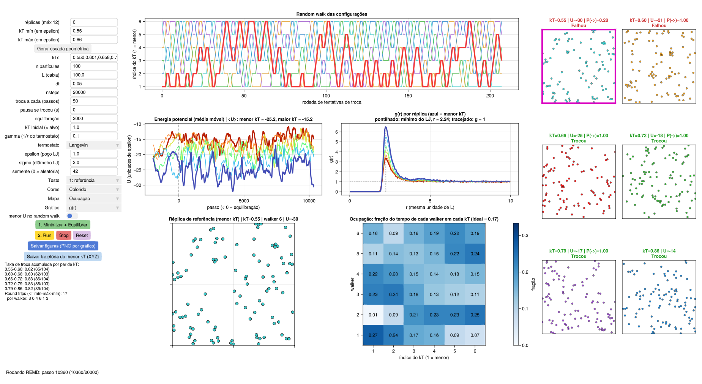

### 6.1 Left column: controls

**Text fields.** Click the field, type the value and press Enter. Use a dot as the decimal separator.

| Field | Default | Meaning |
| --- | --- | --- |
| réplicas (máx 12) (replicas, max 12) | 6 | Number of temperatures, used by the "Gerar escada geométrica" button |
| kT mín (em epsilon) | 0.55 | Lowest temperature, used by the same button |
| kT máx (em epsilon) | 0.86 | Highest temperature, used by the same button |
| kTs | 0.550,0.601,0.658,0.719,0.786,0.860 | The list of temperatures the simulation actually uses, comma-separated |
| n partículas (n particles) | 100 | Number of particles in each replica |
| L (caixa) (box) | 100 | Side of the square box |
| dt | 0.05 | Integration time step |
| nsteps | 20000 | Steps run at each click on Run |
| troca a cada (passos) (exchange every, steps) | 50 | Dynamics steps between two rounds of exchange attempts |
| pausa se trocou (s) (pause on swap) | 0.3 | Time the screen freezes when a swap is accepted (display only) |
| equilibração (equilibration) | 2000 | Steps without swaps run by button 1 |
| gamma (atrito) (friction) | 0.1 | Friction coefficient of the Langevin thermostat |
| epsilon (poço LJ) (LJ well) | 1.0 | Depth of the Lennard-Jones well |
| sigma (diâmetro LJ) (LJ diameter) | 2.0 | Particle diameter |
| semente (0 = aleatória) (seed, 0 = random) | 0 | Random number seed |

**Note**: the fields "réplicas", "kT mín" and "kT máx" do not enter the simulation directly. They only let the **Gerar escada geométrica** (Generate geometric ladder) button fill in the **kTs** field, which is the one that counts.

**When each change takes effect**

| Field changed | Takes effect |
| --- | --- |
| kTs, n, L, epsilon, sigma, seed | Only after clicking Reset or button 1 (the system is rebuilt) |
| dt, gamma, nsteps, exchange interval, pause | At the next click on Run |
| equilibration | At the next click on button 1 |

**Menus and switch**

| Control | Options | Function |
| --- | --- | --- |
| Teste (Test) | "1: referência" to "9: faixa fria" | Fills the fields with the settings of a test from section 9 |
| Cores (Colors) | "Destaque" (Highlight) / "Colorido" (Colorful) | How walkers are painted (section 6.4) |
| Mapa (Map) | "Ocupação" (Occupancy) / "Menor energia" (Lowest energy) / "Taxa de troca (kT)" (Exchange rate) / "Trocas entre walkers" (Swaps between walkers) | Which map appears in the lower right panel of the center column (section 6.3) |
| menor U no random walk (lowest U in the random walk) | on / off | Shows, in the random walk, which kT held the lowest-energy configuration; with the switch on, the walker lines are drawn lighter so these points stand out |

**Buttons**

| Button | What it does |
| --- | --- |
| Gerar escada geométrica (Generate geometric ladder) | Fills kTs with a geometric progression between kT mín and kT máx |
| 1. Minimizar + Equilibrar (Minimize + Equilibrate) | Rebuilds the system, minimizes the energy and equilibrates each replica at its kT, without swaps |
| 2. Run | Runs REMD for nsteps steps. Clicking again continues from where it stopped |
| Stop | Stops the equilibration or the run in progress |
| Reset | Rebuilds the system with the values in the fields. If a run is in progress, the first click stops it and the second rebuilds |
| Salvar figuras (PNG por gráfico) (Save figures, one PNG per plot) | Writes a PNG of each plot (section 12) |
| Salvar trajetória do menor kT (XYZ) (Save lowest-kT trajectory) | Writes the trajectory of the reference replica (section 12) |

**Statistics text.** Below the buttons, during a run, you will see:

```
Taxa de troca acumulada por par de kT:
0.55-0.60: 0.61 (122/200)
...
Round trips (kT mín-máx-mín): 42
  por walker: 6 6 6 9 10 5
```

The first line reads "cumulative exchange rate per kT pair". Each pair line shows the two temperatures, the fraction of accepted swaps and, in parentheses, accepted/attempted. The last line ("por walker") gives the round trips of each walker.

### 6.2 Right column: the replicas

One panel per state, from the lowest kT (first) to the highest (last). The title of each one shows:

- `kT=…`: the temperature of the state (fixed).
- `U=…`: the potential energy of the configuration currently there.
- `P(->)=…`: the probability computed in the last exchange attempt with the next state.
- `Trocou` (swapped) in green or `Falhou` (failed) in red: the outcome of the attempt in the most recent round. Since pairs alternate, a state that did not take part in that round has no label.

One of the panels has a **thick magenta frame**: it is the state that holds, at that moment, the configuration with the lowest potential energy of all.

### 6.3 Center column: the plots

**Random walk das configurações** (random walk of the configurations, top). x axis: round of exchange attempts. y axis: state index (1 = lowest kT). There is one line per walker, showing which state it was in at each attempt. This is the most important plot for judging replica mixing.

**Energia potencial por réplica** (potential energy per replica, middle left). One curve per state, from blue (lowest kT) to red (highest kT). It shows the moving average of the energy, to smooth out noise.
- Negative steps are the equilibration; the vertical dashed line at 0 marks the start of the swaps.
- The curves of the two ends of the ladder are thicker.
- The title shows the mean U at the lowest and at the highest kT.

**P(U) por réplica** (P(U) per replica, middle right). One potential energy histogram per state, with the same colors. It is accumulated only during Run. It shows directly the overlap that controls the exchange rate.

**Réplica de referência** (reference replica, bottom left). A larger view of the lowest-kT state. The title says which walker is there and its energy.

**Mapa** (map, bottom right). One of four maps, chosen in the "Mapa" menu:

| Map | Axes | Each cell shows | Ideal value |
| --- | --- | --- | --- |
| Ocupação (Occupancy) | kT × walker | Fraction of time the walker spent at that kT | 1/R everywhere |
| Menor energia (Lowest energy) | kT × walker | Fraction of time in which the lowest-U configuration was at that kT and was that walker. The title gives the sum per kT | Concentrated at low kT, spread among walkers |
| Taxa de troca (kT) (Exchange rate) | kT × kT | Accepted / attempted swaps between two neighboring kT | 0.2 to 0.3 |
| Trocas entre walkers (Swaps between walkers) | walker × walker | Fraction of all accepted swaps that happened between those two walkers | 1/[R(R−1)/2] everywhere |

In the exchange rate map, only the cells next to the diagonal are filled, because only neighboring states attempt to swap.

The color bar next to each map is its legend. In the occupancy map the scale goes from 0 to 2/R, so the ideal value 1/R sits in the middle of the bar: a map in uniform medium blue means good mixing.

### 6.4 Colors

- **Destaque** (Highlight): walker 1 (the configuration that started at the lowest kT) is red and the others are gray. Useful to follow a single configuration along the ladder.
- **Colorido** (Colorful): each walker has its own color. Useful to see all the swaps.

In the random walk, the line of walker 1 is always thicker.

### 6.5 Bottom line

The bottom line shows what the GUI is doing ("Minimizando..." for minimizing, "Rodando REMD: passo …" for running), where files were saved, and error messages, which start with "ERRO:".

## 7. First simulation, step by step

The goal here is only to learn how to operate the GUI and read the screen. Use the values below.

**Step 1. Check the ladder.** The default values already match test 1:

- réplicas: `6`
- kT mín: `0.55`
- kT máx: `0.86`
- kTs: `0.550,0.601,0.658,0.719,0.786,0.860`

If you changed any of these fields, set them again and click **Gerar escada geométrica**.

**Step 2. Fix the seed.** In the seed field, type `42`. With a fixed seed, the simulation can be repeated.

**Step 3. Choose the colors.** In the Cores menu, select **Colorido**.

**Step 4. Prepare the system.** Click **1. Minimizar + Equilibrar**.

What to watch:
- The bottom line shows "Minimizando..." and then "Equilibrando cada réplica no seu kT (sem trocas)..." (equilibrating each replica at its kT, without swaps).
- All panels on the right start from the same configuration and gradually become different.
- In the energy plot, the curves appear at negative steps. They start from close values (the minimized configuration) and split apart: the red one (highest kT) rises the most, the blue one (lowest kT) stays lowest.
- At the end, the bottom line says "Equilibração concluída. Clique em '2. Run'." (equilibration finished).

**Step 5. Run.** Click **2. Run**.

What to watch, in order:

1. **Panels on the right.** Every 50 steps the titles turn green ("Trocou") or red ("Falhou"). When a swap is accepted, the screen pauses for 0.3 s and you see two colors change panels.
2. **Random walk.** The lines start apart, one on each level, and become intertwined. Follow one color: it should go up and down the whole ladder.
3. **P(U).** The six histograms build up. Note that neighbors overlap a lot.
4. **Statistics text.** The exchange rate of each pair settles after a few dozen attempts. The round trip counter starts to increase.
5. **Magenta frame.** It stays on the first panel most of the time, but sometimes jumps to the second or third.

**Step 6. Explore the maps.** With the run in progress or finished, switch the Mapa menu between the four options and read each one using the table in section 6.3.

**Observed result with these settings**: exchange rate between 0.6 and 0.8 in all pairs, usually lowest in the coldest pair, and a few dozen round trips in 20 000 steps (45 in one of the runs). The values change with the seed.

**Questions**

1. Why does the magenta frame sometimes leave the first panel?
   *Answer*: because the P(U) distributions overlap. Every now and then, a hotter replica has lower energy than the reference one. This same overlap is what makes swaps possible.
2. Is the exchange rate in the ideal range (0.2 to 0.3)?
   *Answer*: no, it is above it. The ladder has more replicas than this temperature range needs. Test 2 deals with this.
3. Why is the exchange rate lower in the cold pairs?
   *Answer*: in the cold region clusters form, the energy changes more with temperature and the distributions of neighbors move further apart.

## 8. The control parameters

This section explains each parameter: what it is, how it affects sampling and how to choose its value.

### 8.1 The temperature ladder

The ladder is the main control of REMD. It decides two independent things:

1. Whether swaps happen (spacing between neighbors).
2. Whether the hot replicas are hot enough to cross barriers (maximum temperature).

#### kT mín

This is the temperature you want to study. It is not a tuning parameter; it comes from the physical question. The lower it is, the more the system gets trapped and the more REMD has to offer, but also the wider the range to cover.

#### kT máx

This is the temperature at the top of the ladder. It must be high enough for the system to quickly "forget" where it was: in the GUI, for clusters to break up and re-form within a few steps.

| If kT máx is… | Consequence |
| --- | --- |
| Too low | Swaps work and the random walk looks fine, but no replica crosses the barriers. Sampling at kT mín does not improve, even though the mixing indicators look good |
| Too high | The range to cover grows, and more replicas are needed to keep swaps going. Wasted cost |

How to choose: look at the highest-kT panel. If the particles are spread out there and clusters do not persist, the top of the ladder is doing its job.

#### Number of replicas and spacing

For a fixed range, more replicas mean closer neighbors, more P(U) overlap and a higher exchange rate. But each replica costs a whole simulation, and a walker has more rungs to travel.

**Why the right spacing depends on system size.** For two neighboring states separated by ΔT:

- The distance between mean energies is ΔU ≈ C·ΔT, where C is the heat capacity. C is proportional to the number of particles n.
- The width of each distribution is σ_U = T·√(k·C), proportional to √n.

The overlap depends on the ratio between the two:

```math
\frac{\Delta U}{\sigma_U} \approx \sqrt{\frac{C}{k}}\;\frac{\Delta T}{T} \;\propto\; \sqrt{n}\;\frac{\Delta T}{T}
```

Two conclusions follow:

1. To keep the same overlap along the whole ladder, ΔT/T must be constant. That is a **geometric progression** of temperatures.
2. To keep the overlap when the system grows, ΔT/T must shrink as 1/√n. The number of replicas needed to cover a range grows as **√n**.

The second conclusion is why T-REMD becomes expensive for large systems, such as proteins in explicit water (section 11).

#### The kTs field and the geometric ladder

The **Gerar escada geométrica** button computes

```math
kT_i = kT_{\min}\left(\frac{kT_{\max}}{kT_{\min}}\right)^{\frac{i-1}{R-1}}, \qquad i = 1, \dots, R
```

The geometric progression gives a uniform exchange rate **if the heat capacity is constant** along the ladder. In this system it is not: in the region where clusters form, the energy changes a lot with temperature, and the pairs in that region accept fewer swaps.

When the exchange rate is not uniform, edit the kTs field by hand: bring temperatures closer where the rate is low and spread them where it is high. Then click button 1 to apply.

#### How to judge the ladder

| Exchange rate per pair | Interpretation |
| --- | --- |
| Below 0.1 | Bottleneck. Walkers hardly cross this rung |
| 0.2 to 0.3 | Usual target range. Up to 0.4 is acceptable |
| Above 0.5 or 0.6 in all pairs | Too many replicas. You can remove some or raise kT máx |

Ideally the rate should be **similar in all pairs**. A single bad pair limits the whole ladder.

### 8.2 System size and density

#### n particles

This is the system parameter that affects REMD the most, by the argument in section 8.1: with more particles, the energy distributions of neighbors move apart faster than they widen, and the exchange rate drops for the same ladder. Doubling n calls for about √2 times more replicas.

The computational cost per step in the GUI grows as n², because every pair is computed.

#### L (box)

Together with n, it sets the density n/L². A smaller box increases the density, makes the energy more negative at all temperatures and shifts the region where clusters form to higher kT. If you change L, a ladder that used to work may stop working.

#### epsilon and sigma

- **epsilon**: what matters is the ratio kT/epsilon. Doubling epsilon is the same as halving every temperature on the ladder. Since the time unit depends on epsilon, the same dt corresponds to a step √2 times larger in reduced units, and the integration becomes less stable.
- **sigma**: sets the particle size and, together with n and L, the fraction of the box that is occupied.

In general there is no reason to change these two in the tutorial.

### 8.3 Integration and thermostat

#### dt

The integration time step. A larger dt covers more time per step, but beyond a certain limit the integration becomes unstable and the energy blows up.

REMD adds a caveat: **the dt limit is set by the hottest replica**, where particles are fastest and collisions most violent. A dt that is fine at kT mín may be unstable at kT máx. If the energy of a hot panel blows up, reduce dt.

Observed: dt = 0.05 was stable up to kT = 0.86. Above that, check.

#### gamma (friction)

The friction coefficient of the Langevin thermostat. The temperature relaxation time is of the order of 1/gamma.

| gamma | Behavior |
| --- | --- |
| Small (0.01) | Nearly Newtonian dynamics; the temperature takes long to adjust |
| Default (0.1) | Relaxation in 1/0.1 = 10 time units, or 200 steps with dt = 0.05 |
| Large (1 or more) | The temperature adjusts quickly, but motion becomes diffusive and the system explores space more slowly |

In REMD, gamma controls how much each replica decorrelates between two exchange attempts. There is no need to re-equilibrate after an accepted swap: since the criterion satisfies detailed balance and the velocities are rescaled, the configuration received is already a valid sample of the new kT. With gamma too large, motion becomes diffusive, the configuration changes little between attempts and the same pair tends to swap and swap back.

### 8.4 Exchange frequency

The field "troca a cada (passos)" is the number of dynamics steps between two rounds of attempts.

| Interval | Effect |
| --- | --- |
| Small | More attempts per simulated time; walkers travel the ladder faster |
| Large | Each replica has more time to explore at its new temperature before the next attempt, but the ladder is traveled slowly |

Two useful facts:

- Attempting more often **does not break** detailed balance. Each state remains canonical.
- The exchange rate (accepted fraction) hardly depends on the interval. What changes is the **number** of swaps per simulated time, and therefore the number of round trips.

In the literature, the general recommendation is to attempt swaps often (Sindhikara et al., 2008). The GUI default, 50 steps, is shorter than the relaxation time of the thermostat (about 200 steps).

The field "pausa se trocou" does not change the simulation; it only freezes the screen so swaps can be seen. Use 0 to run at full speed.

### 8.5 Preparation: minimization and equilibration

Button 1 does three things:

1. **Rebuilds the system** with random positions. Particles may overlap, with huge energy.
2. **Minimizes**: moves the particles along the forces, in steps of at most 0.05, for 500 iterations, which is enough to remove overlaps. Without this, the first dynamics step would blow up.
3. **Equilibrates**: copies the minimized configuration to all replicas, draws velocities at the temperature of each one and runs the dynamics **without swaps** for the number of steps in the "equilibração" field.

Why equilibrate without swaps: all replicas start from the same configuration, so at first none of them is in equilibrium with its kT. If swaps started right away, the first ones would reflect this relaxation and not the behavior of the ladder.

How to tell whether the equilibration was enough: in the energy plot, the curves (at negative steps) should have stopped drifting and be separated by temperature when they reach the dashed line. Cold replicas take the longest, because forming clusters is slow. If the blue curve is still dropping at step 0, increase the number of equilibration steps.

### 8.6 Run length

"nsteps" is the number of steps per click on Run. Further clicks accumulate statistics.

Run length should not be judged by the number of steps, but by the number of **round trips**: how many times each walker went from the lowest to the highest kT and back. Each round trip is, roughly, one chance to deliver a new, decorrelated configuration to the reference replica. With few round trips, the averages at kT mín still depend on where the system started.

The GUI counts a round trip when a walker that has already touched the highest kT comes back to the lowest. The counter is in the statistics text, in the left column, below the buttons: the line "Round trips (kT mín-máx-mín)" gives the total, and the line "por walker" gives the count for each walker. The text only appears after the first round of swaps.

### 8.7 Seed

Sets the initial positions, the velocities, the thermostat noise and the random draws of the swaps.

- `0`: a new seed is drawn at each Reset. Use it to see the variability between runs.
- Any other value: the simulation is repeatable.

To compare two values of a parameter fairly, use the same seed for both.

## 9. Tests

Each test changes **one** parameter relative to the reference. For all of them:

- Select the test in the **Teste** menu. It fills every field with the values below, including seed `42` and pause `0`, but does not start the simulation. Tests with variants appear separately in the menu (for example, "2a: 3 réplicas" and "2b: 2 réplicas"). Test 5 has no entry of its own: it starts from configuration "4a" with the kTs list edited by hand.
- Use the "Colorido" colors.
- Click **1. Minimizar + Equilibrar** and then **2. Run**.
- At the end, click **Salvar figuras** and write down the exchange rate per pair and the round trips.

A table to record the results:

| Test | Replicas | kT min–max | n | Exchange every | Exchange rate (min–max) | Round trips | Notes |
| --- | --- | --- | --- | --- | --- | --- | --- |
| 1 | 6 | 0.55–0.86 | 100 | 50 | | | |
| 2 | 3 | 0.55–0.86 | 100 | 50 | | | |
| … | | | | | | | |

### Test 1: reference

**Goal**: have a baseline run and learn to read the panels.

**Settings**: 6 replicas, kT from 0.55 to 0.86 on a geometric ladder; other fields at their defaults; nsteps 20000.

**What to look at**
- Random walk: do all colors travel through the six levels?
- P(U): how much do neighboring histograms overlap?
- "Ocupação" map: are the cells close to 1/6 ≈ 0.17?
- "Taxa de troca (kT)" map: which pair has the lowest rate?

**Observed** (one run of 20 000 steps): exchange rate from 0.63 to 0.80, with the lowest value in the coldest pair; 45 round trips; occupancy between 0.11 and 0.26, around the ideal 0.17.


| Exchange rate | Occupancy | Lowest energy |
| --- | --- | --- |
|  |  |  |

The lowest-energy configuration was at the lowest kT 52 % of the time, at the second state 25 % of the time and at the others for the rest, which reflects the overlap of the P(U).

**Conclusion**: configurations travel well along the ladder, but it is denser than necessary.

### Test 2: fewer replicas over the same range

**Goal**: see that the spacing controls the exchange rate.

**Settings**: as in test 1, but with 3 replicas (click "Gerar escada geométrica" again). Repeat with 2 replicas.

**Expected with 3 replicas**: neighboring P(U) histograms overlap less and the exchange rate is lower in all pairs.

**Observed with 2 replicas** (preset "2b: 2 réplicas", seed 42, 20 000 steps): the difference between the two temperatures is 56 % (versus 9 % in test 1).

- Exchange rate 0.04 (8 accepted swaps out of 200 attempts); 7 round trips.
- The two histograms are well apart: the one at kT = 0.55 spans roughly −47 to −15, the one at kT = 0.86 spans −20 to −5. They only cross between −22 and −17.
- The random walk has stretches of almost 150 rounds without a single swap. The few swaps come in short bursts: when a fluctuation brings both energies into the common range, the swap is accepted and the swap back tends to be accepted too.
- In the panels on the right, with U = −26 at kT = 0.55 and U = −8 at kT = 0.86, the computed probability is P ≈ 10⁻⁵, shown as 0.00.
- The lowest-energy configuration stayed at kT = 0.55 98 % of the time (52 % in test 1).

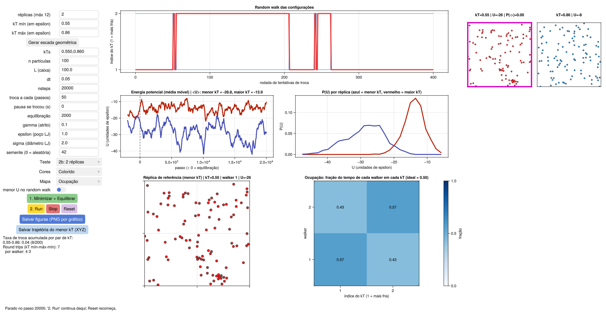

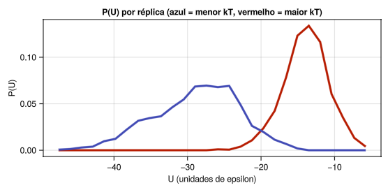

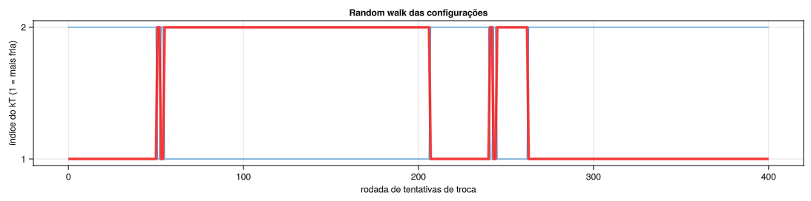

| Replica panels | Occupancy |
| --- | --- |
| 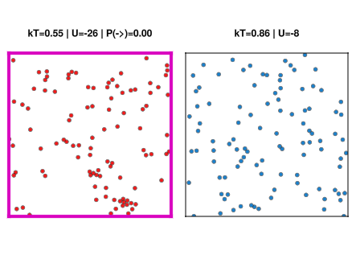 | 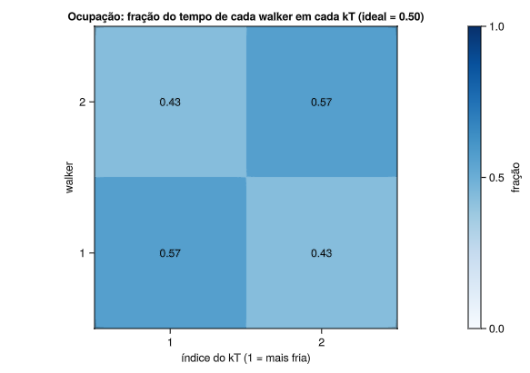 |

**A word of caution about occupancy**: it came out as 0.57 / 0.43, close to the ideal 0.50, but with only 8 swaps this number has little statistics behind it. Occupancy alone does not tell whether the ladder works; look at it together with the exchange rate and the random walk. The "Trocas entre walkers" map says nothing with 2 replicas, because there is only one pair of walkers.

**Mean energy at kT = 0.55**: −28.8 here, versus −23.2 in test 1. In a converged ensemble the two would be equal. The difference shows that the energy at the coldest temperature has large, slow fluctuations (clusters forming and breaking), and that 20 000 steps are not enough to converge this average, especially when there are almost no swaps.

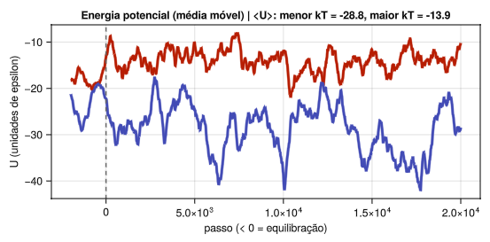

**Question**: what number of replicas brings the exchange rate close to 0.2–0.3 over this range?

### Test 3: wide range with few replicas

**Goal**: see the case where REMD degenerates into independent simulations.

**Settings**: 3 replicas, kT mín 0.35, kT máx 1.2. Increase the equilibration to 5000.

**Expected**
- Separate P(U) histograms, with no overlap.
- Exchange rate close to zero.
- Random walk with horizontal lines: each walker stays on the level where it started.
- Diagonal "Ocupação" map: each walker at a single kT.
- Zero round trips.

**Caution**: with kT máx 1.2, check that the energy of the hottest panel does not blow up. If it does, reduce dt to 0.02.

**Conclusion**: without energy overlap there are no swaps, and the R simulations do not help each other.

### Test 4: same range with more replicas

**Goal**: get swaps back by adding replicas.

**Settings**: as in test 3, with 8 replicas; then 10.

**Expected**
- Swaps come back.
- The exchange rate is not uniform: pairs in the cold region accept fewer swaps than those in the hot region.
- The random walk shows walkers that move well in the upper part of the ladder and struggle in the lower part.

**Question**: which pair is the bottleneck? Use the "Taxa de troca (kT)" map.

### Test 5: hand-tuned ladder

**Goal**: make the exchange rate uniform without adding replicas.

**Settings**: start from the ladder of test 4. Edit the kTs field: bring temperatures closer in the region where the rate was low and spread them where it was high, keeping the first and last values. Click button 1 and run.

**Expected**: a more uniform exchange rate and more round trips for the same cost.

**Procedure**: run, find the pair with the lowest rate, bring its two temperatures closer and repeat. Systematic methods to optimize the ladder are described in the literature (for example, Katzgraber et al., 2006).

### Test 6: exchange frequency

**Goal**: see that the attempt frequency controls the speed of the random walk.

**Settings**: on the ladder of test 1 (or 5), run three times, with "troca a cada" equal to 10, 50 and 500, always with nsteps 20000.

**Expected**
- The exchange rate (accepted fraction) is similar in the three cases.
- The number of attempt rounds is 2000, 400 and 40, respectively (each pair is tested in half of them).
- The number of round trips drops sharply with the larger interval.

**Conclusion**: for the same cost, attempting swaps more often delivers more configurations to the reference replica.

### Test 7: system size

**Goal**: see the √n dependence.

**Settings**: on the ladder of test 1, change n to 200 and L to 141 (keeps the density). Then n 400 and L 200. The simulation gets slower.

**Expected**
- The exchange rate drops in all pairs as n increases.
- The P(U) histograms become narrower relative to the distance between them.

**Question**: how many replicas would n = 400 need to have the same exchange rate that n = 100 had with 6? *Estimate*: √4 = 2 times more intervals, that is, about 11 replicas.

### Test 8: bottleneck in the middle of the ladder

**Goal**: see the effect of an uneven ladder and recognize a bottleneck in the maps.

**Settings**: type the list `0.55,0.58,0.61,0.80,0.83,0.86` in the kTs field and click button 1. These are three close temperatures at the bottom, three at the top and a 31 % jump in the middle (versus 4 to 5 % in the other pairs).

**Observed** (preset "8: gargalo", seed 42, 20 000 steps)
- Exchange rates: 0.76 / 0.77 / **0.29** / 0.92 / 0.91. The pair across the jump dropped, but is still in the 0.2–0.3 range.
- 28 round trips (45 in test 1).
- "Trocas entre walkers" map: nearly uniform (0.05 to 0.09), with no blocks.
- "Ocupação" map: starts to separate the walkers. Walkers 3 and 5 spent more time in the cold (0.23 and 0.28 at kT = 0.55); walkers 1, 2 and 6 more in the hot.
- P(U): the three cold curves and the three hot ones form two groups, but the one at kT = 0.61 still touches the one at kT = 0.80.

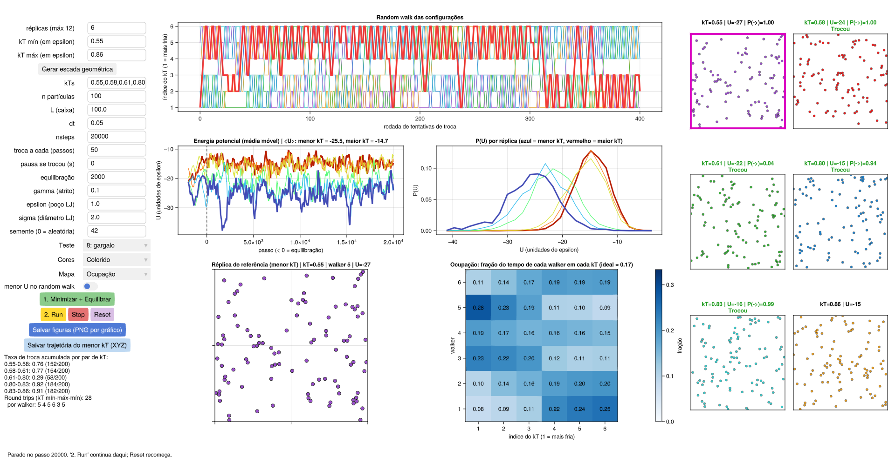

| Exchange rate | Occupancy | Swaps between walkers |
| --- | --- | --- |
| 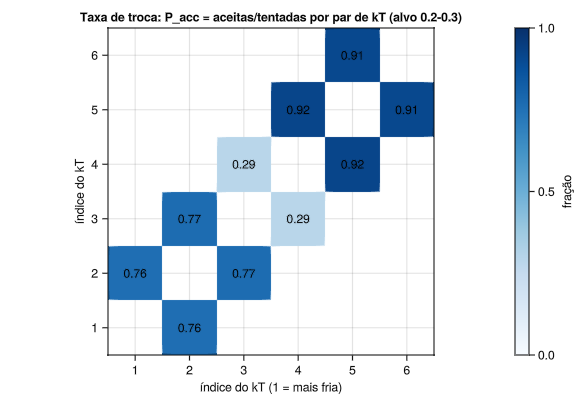 | 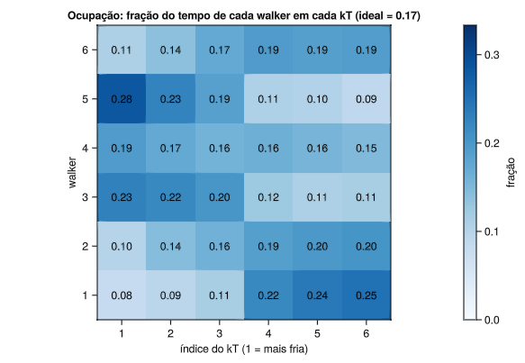 | 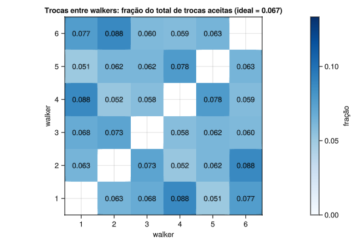 |

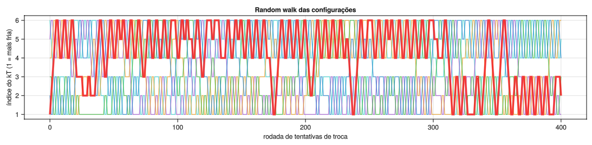

**Interpretation**: the jump did not create a full bottleneck, because the energy distributions in this range still overlap. The result is an unbalanced ladder: the upper pairs swap more than 90 % of the time, which wastes replicas, and the middle pair narrows the path and reduces the round trips. With the same six replicas, a geometric ladder would mix better.

**To see a full bottleneck**, make the jump larger: `0.55,0.57,0.59,0.95,0.98,1.01` (61 % between 0.59 and 0.95, similar to test 2b). Expect a rate close to zero in pair 3-4, two blocks in the maps and almost no round trips. With kT = 1.01, check that the energy of the hottest panel does not blow up; if it does, reduce dt.

**Conclusion**: what matters is that the rate is similar in all pairs. Always look at the worst pair and at the round trips, not at the average.

### Test 9: a cold range that crosses a transition

**Goal**: see what happens when the ladder crosses a phase transition, and why equilibrium is the first thing to check.

**Settings**: 6 replicas, kT mín 0.35, kT máx 0.45 (narrow, cold range), equilibration 5000.

The initial prediction was good mixing with a top that is too cold. The result was different, and more instructive.

**Observed** (preset "9: faixa fria", seed 42, 20 000 steps)
- In this range the system goes through condensation. Below kT ≈ 0.38 the particles form large clusters (U = −164 at kT = 0.35); above ~0.41 the system is a gas (U ≈ −40).
- The energy of the cold replicas drops throughout the run, from about −20 down to −170, without leveling off: the clusters keep growing and merging.
- Exchange rates: 0.27 / **0.03** / 0.51 / 0.33 / 0.55. The 0.37–0.39 pair, right at the transition, barely swaps.
- No round trips. Occupancy and swaps between walkers form two blocks: walkers 1 and 2 stay at the two coldest temperatures, and walkers 3 to 6 at the four hottest.
- The cold P(U) are wide and have several peaks, because the energy is drifting.

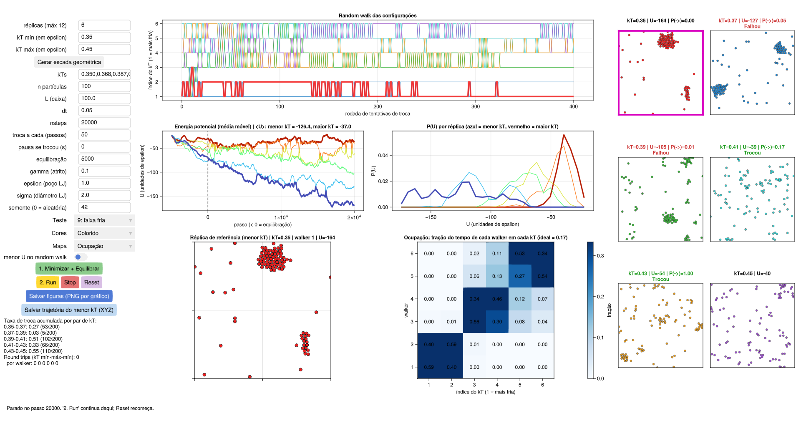

| Replica panels | Energy |
| --- | --- |
| 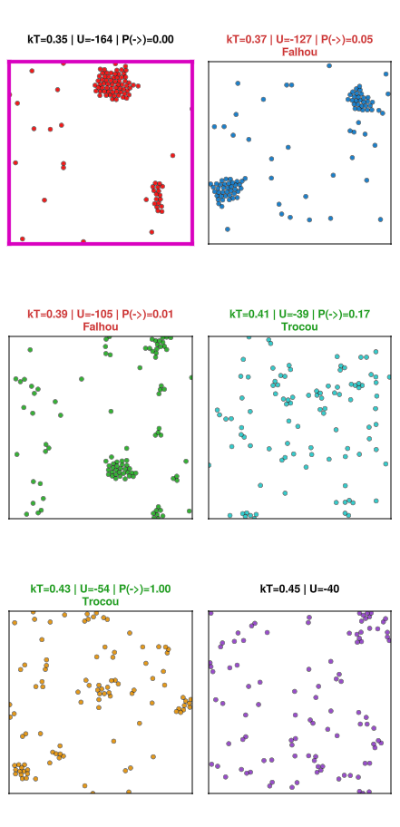 | 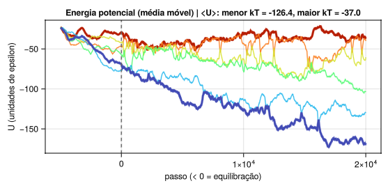 |

| Exchange rate | Occupancy | Swaps between walkers |
| --- | --- | --- |
| 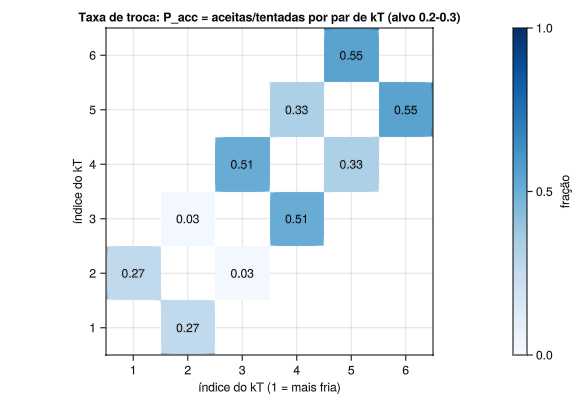 | 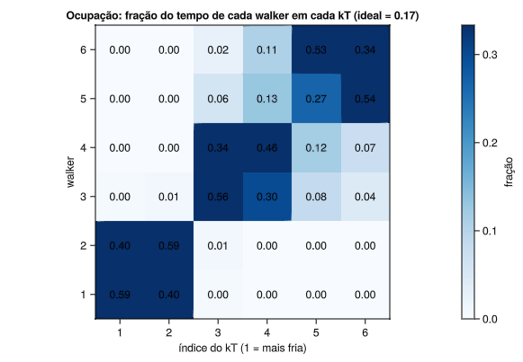 | 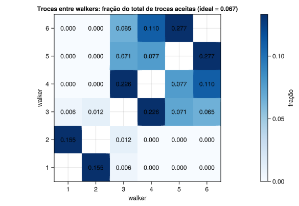 |

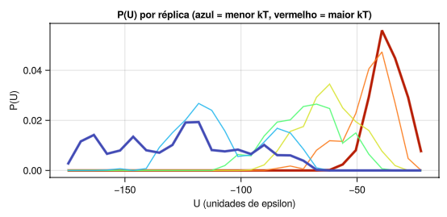

**Interpretation**
1. **The system did not equilibrate.** With the energy dropping the whole time, no average from this run is valid. This is step 1 of the diagnosis (section 10), and it fails before any other.
2. **The transition creates a bottleneck.** At the transition, the energy changes a lot with temperature: the heat capacity has a peak. Neighboring energy distributions move apart, and the geometric ladder, which assumes constant heat capacity, leaves a pair there that barely swaps. The same happens with proteins near the folding temperature; methods such as that of Katzgraber et al. (2006) concentrate replicas in this region.

**Conclusion**: before judging the swaps, check whether the system equilibrated. And across a phase transition the temperatures must be closer together than the geometric ladder suggests.

**The original prediction** (good mixing with a top that is too cold) would require a range entirely below the transition, where all replicas have clusters. In that region equilibration is slow, and the result depends strongly on the run length. The idea still holds in general: exchange rate and round trips tell you whether configurations travel along the ladder, but not whether the maximum temperature crosses the barrier that matters.

## 10. Diagnosis: from symptom to parameter

The tables below link each symptom to the parameter that should be changed. The suggested order is: preparation, replica mixing, and maximum temperature.

**Step 1: is the preparation correct?**

| Symptom | Where it shows | What to change |
| --- | --- | --- |
| Energy curves still drifting at step 0 | Energy plot, negative part | Increase the equilibration |
| Energy of one replica dropping during the whole run | Energy plot, positive part (test 9) | The system did not equilibrate: equilibrate and run much longer; the averages of this run are not valid |
| Exchange rate changes a lot at the start of the run | Statistics text | Same; discard the beginning |

**Step 2: do configurations travel along the ladder?**

| Symptom | Where it shows in the GUI | Likely cause | What to change |
| --- | --- | --- | --- |
| Exchange rate close to zero in one pair | Statistics text; "Taxa de troca (kT)" map; separate P(U) histograms | Neighbors too far apart | Add a replica in that interval or bring the kTs closer |
| Exchange rate above 0.5 in all pairs | Same places; nearly identical P(U) | Too many replicas | Remove replicas or raise kT máx |
| Uneven exchange rate between pairs | "Taxa de troca (kT)" map | Heat capacity varies along the ladder, or uneven spacing (test 8) | Edit kTs: bring them closer where the rate is low |
| One pair barely swaps in the middle of a narrow range | "Taxa de troca (kT)" map; wide or multi-peaked P(U) (test 9) | Phase transition: heat capacity peak | Bring temperatures closer in the transition region |
| Walkers in isolated groups | "Trocas entre walkers" and "Ocupação" maps in blocks; random walk in bands | Bottleneck in one pair | Fix that pair (first row) |
| Few round trips with a reasonable exchange rate | Round trip counter; slow random walk | Too few attempts, or too many replicas to travel | Lower "troca a cada"; run longer; remove replicas if the rate allows |
| Very uneven round trips between walkers | "por walker" in the statistics text | Short run, or a trapped walker | Run longer; check the equilibration |

**Step 3: is the maximum temperature high enough?**

| Symptom | Where it shows | Likely cause | What to change |
| --- | --- | --- | --- |
| Good mixing, but the reference replica does not change | Highest-kT panel with persistent clusters | kT máx too low | Raise kT máx (and replicas, to keep the rate) |
| Energy of a hot panel blows up | Panel title; energy plot | dt too large for the hot replica | Reduce dt |

## 11. From the GUI to a molecular simulation

The GUI parameters have direct counterparts in molecular dynamics packages. The table uses GROMACS as an example.

| In the GUI | In a molecular simulation | In GROMACS |
| --- | --- | --- |
| kTs | Temperature of each replica | A different `ref-t` in the `.mdp` of each directory |
| troca a cada (passos) | Interval between attempts | `mdrun -replex N` |
| Running replicas in parallel | One simulation per replica, synchronized | `mpirun -np R gmx_mpi mdrun -multidir …` |
| gamma (friction) | Thermostat coupling | `tau-t` (with the `sd` integrator, the friction is 1/`tau-t`) |
| equilibration | Equilibrate each replica at its temperature before swaps | NVT/NPT per replica |
| n particles | Total number of atoms, **including the solvent** | — |
| Random walk of the walkers | Replica indices over time | "Repl ex" lines in the log; the `demux.pl` script (in the `scripts/` directory of the source code) with `gmx trjcat -demux` |
| Lowest-kT trajectory | Trajectory of the lowest-temperature directory | The `.xtc` file of that directory, continuous in state |

**The cost of the solvent.** By the argument of section 8.1, the number of replicas grows as √n, and n includes all atoms. In a solvated peptide, most of the atoms are water, and water is what limits the spacing between temperatures. That is why T-REMD in explicit solvent needs many replicas even for small solutes.

**A way out: REST2.** In *Replica Exchange with Solute Tempering* (Wang, Friesner and Berne, 2011), all replicas stay at the same temperature, and what changes is the Hamiltonian: only the solute interactions are scaled, as if only the solute were heated. In the exchange criterion, the water-water terms cancel and only the terms involving the solute remain; that is why a few replicas are enough. The concepts in this tutorial (overlap, exchange rate, round trips, bottleneck, a top hot enough) apply in the same way; only what the "ladder" is changes.

**Other points to watch in real simulations**

- In NPT, the exchange criterion gains a term with pressure and volume. Many protocols use NVT in production for simplicity.
- The trajectory of each directory is continuous in state, not in configuration. To follow a configuration (for example, to compute RMSD over time), you have to demultiplex.
- Only the state of interest gives the physical ensemble directly. Using the others requires reweighting (WHAM, MBAR).

## 12. Saving figures and trajectories

### 12.1 Figures

Figures and trajectories are saved in a folder named after the test chosen in the Teste menu (for example, `teste8_gargalo/`), created in the directory Julia was started from. If no test is chosen, the folder is `sem_teste/` ("no test").

The **Salvar figuras (PNG por gráfico)** button creates, inside that folder, a subfolder with a name like

```
teste1_referencia/remd_figs_R6_kT0.55-0.86_n100_troca50_passo20000/
```

containing:

| File | Content |
| --- | --- |
| `random_walk.png` | Random walk of the configurations |
| `energia.png` | Potential energy per replica |
| `P_U.png` | P(U) histograms |
| `replica_referencia.png` | Reference replica |
| `replicas.png` | All replica panels |
| `mapa_ocupacao.png` | Occupancy map |
| `mapa_menor_energia.png` | Lowest energy map |
| `mapa_taxa_de_troca.png` | Exchange rate map |
| `mapa_trocas_walkers.png` | Swaps between walkers map |
| `janela_completa.png` | The whole window |

The four maps are saved regardless of which one is selected. The resolution is that of the window; maximize it before saving to get larger figures.

### 12.2 Trajectory

The **Salvar trajetória do menor kT (XYZ)** button writes two files in the test folder:

- `remd_traj_….xyz`: one frame every 10 Run steps, always from the lowest-kT state. The equilibration is not included. The comment line of each frame holds the step, the walker that was there, the energy, the kT and L.
- `remd_traj_….tcl`: a VMD script that loads the trajectory with the right representation.

To view it:

```bash
vmd -e remd_traj_….tcl
```

On Windows, VMD is usually opened from the Start menu. In that case, open **Extensions → Tk Console** and type `source C:/path/remd_traj_….tcl` (the bottom line of the GUI shows the full command). The `.tcl` uses the absolute path of the `.xyz`, so it works from any folder.

Opening the `.xyz` directly also works; in that case, in Graphics → Representations, change the Drawing Method to VDW.

**How to interpret the trajectory.** It is continuous in **state**: it always shows what was at kT mín. At each accepted swap in the coldest pair, the positions jump, because another configuration took its place. These jumps are expected. Averages computed over this trajectory are canonical averages at kT mín.

Reset or a new equilibration clears the accumulated frames. The limit is 50 000 frames.

## 13. Common problems when using the GUI

| Problem | Cause and fix |
| --- | --- |
| Windows: "julia" is not recognized as a command | Julia is not in the PATH. Reopen the terminal after installing; with the julialang.org installer, tick the "Add Julia to PATH" option |
| Windows: the GUI window does not open (OpenGL error) | GLMakie requires OpenGL 3.3. Update the graphics driver; remote desktop sessions and virtual machines may not support it |
| The window takes very long to open the first time | Normal: Julia is compiling GLMakie. Later launches are faster |
| I changed kTs (or n, L) and nothing happened | These fields only take effect after Reset or button 1 |
| I typed a value and it was not accepted | Press Enter after typing. Use a dot as the decimal separator |
| "ERRO: minimize e equilibre primeiro (botão 1)" | Error: minimize and equilibrate first. Click button 1 before Run |
| "Já há uma simulação em andamento. Use Stop antes." | A simulation is already running. Click Stop and wait for the message "Parado no passo …" (stopped at step …) |
| The energy of a panel goes to huge values | dt too large for that temperature. Reduce dt and start again from button 1 |
| The simulation is very slow | Set "pausa se trocou" to 0; reduce n; check that Julia was started with `-t auto` |
| Part of the window is cut off | Maximize or resize the window; the plots follow |
| The number of round trips is zero | The run is short, or there is a bottleneck. Look at the "Taxa de troca (kT)" map |

## 14. Limitations of the model

- **It is a teaching model.** A dilute 2D Lennard-Jones gas does not have barriers as high as those of a biomolecule, and the sampling gain from REMD is smaller than in real systems.
- **The GUI shows the mechanics of the method, not the final gain.** The panels diagnose how configurations travel along the ladder. The current version has no structural observable comparing the reference replica with and without swaps.
- **O(n²) cost.** With no cutoff and no neighbor list, systems with more than a few hundred particles become slow.
- **Short statistics.** Runs of 20 000 steps give a few hundred attempts per pair. Exchange rates have an uncertainty of a few hundredths, and the per-walker maps are even noisier. Small differences between runs may be just fluctuation; repeat with another seed before drawing conclusions.
- **T-REMD only.** Variants such as REST2 and Hamiltonian REMD are not implemented.

## 15. Glossary

| Term | Meaning |
| --- | --- |
| Replica | One of the copies of the system simulated in parallel |
| State | One temperature of the ladder; fixed |
| Walker | A configuration (positions and velocities) that moves between states |
| Temperature ladder | The set of temperatures |
| Replica mixing | How well configurations travel through all the temperatures of the ladder |
| Reference replica | The lowest-kT state, the one of interest |
| Exchange rate (P_acc) | Fraction of exchange attempts accepted in a pair of neighboring states; also called acceptance rate |
| P(U) | Distribution of the potential energy in a state |
| Overlap | Range of energies that two neighboring states visit in common |
| Random walk | The path of a walker through the states as swaps happen |
| Round trip | A walker going from the lowest to the highest kT and back |
| Occupancy | Fraction of time a walker spends in each state |
| Bottleneck | A pair of states with a very low exchange rate, which splits the ladder |
| Detailed balance | At equilibrium, each transition happens as often as its reverse; this is what guarantees that the exchange criterion preserves the ensemble of each state |
| Quasi-ergodicity | When the simulation is trapped in one region and does not sample the full ensemble |
| Demultiplexing | Rebuilding the continuous trajectory of each walker from the per-state trajectories |
| REST2 | A variant in which only the solute interactions are scaled, reducing the number of replicas |

## 16. References

**The method**
- Hukushima, K.; Nemoto, K. Exchange Monte Carlo method and application to spin glass simulations. *J. Phys. Soc. Jpn.* **65**, 1604 (1996). doi:10.1143/JPSJ.65.1604
- Sugita, Y.; Okamoto, Y. Replica-exchange molecular dynamics method for protein folding. *Chem. Phys. Lett.* **314**, 141 (1999). doi:10.1016/S0009-2614(99)01123-9
- Earl, D. J.; Deem, M. W. Parallel tempering: theory, applications, and new perspectives. *Phys. Chem. Chem. Phys.* **7**, 3910 (2005). doi:10.1039/B509983H

**Choosing the ladder and the exchange rate**
- Kofke, D. A. On the acceptance probability of replica-exchange Monte Carlo trials. *J. Chem. Phys.* **117**, 6911 (2002). doi:10.1063/1.1507776. Erratum: *J. Chem. Phys.* **120**, 10852 (2004).
- Rathore, N.; Chopra, M.; de Pablo, J. J. Optimal allocation of replicas in parallel tempering simulations. *J. Chem. Phys.* **122**, 024111 (2005). doi:10.1063/1.1831273
- Katzgraber, H. G.; Trebst, S.; Huse, D. A.; Troyer, M. Feedback-optimized parallel tempering Monte Carlo. *J. Stat. Mech.: Theory Exp.* (2006) P03018. doi:10.1088/1742-5468/2006/03/P03018
- Patriksson, A.; van der Spoel, D. A temperature predictor for parallel tempering simulations. *Phys. Chem. Chem. Phys.* **10**, 2073 (2008). doi:10.1039/B716554D

**Exchange frequency**
- Sindhikara, D.; Meng, Y.; Roitberg, A. E. Exchange frequency in replica exchange molecular dynamics. *J. Chem. Phys.* **128**, 024103 (2008). doi:10.1063/1.2816560

**Variants**
- Wang, L.; Friesner, R. A.; Berne, B. J. Replica exchange with solute scaling: a more efficient version of replica exchange with solute tempering (REST2). *J. Phys. Chem. B* **115**, 9431 (2011). doi:10.1021/jp204407d

**Integrator**
- Leimkuhler, B.; Matthews, C. Rational construction of stochastic numerical methods for molecular sampling. *Appl. Math. Res. eXpress* **2013**, 34–56 (2013). doi:10.1093/amrx/abs010

**Related material**
- Martínez, L. FundamentosDMC.jl: teaching material on molecular dynamics simulations (in Portuguese), which inspired the interface. https://github.com/m3g/FundamentosDMC.jl
